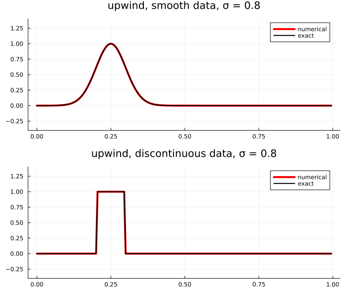
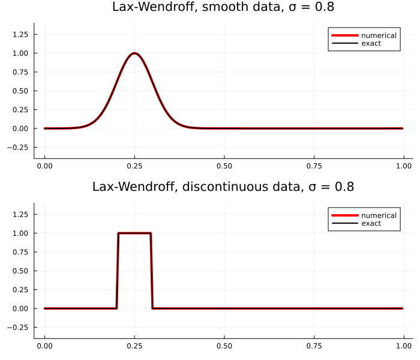
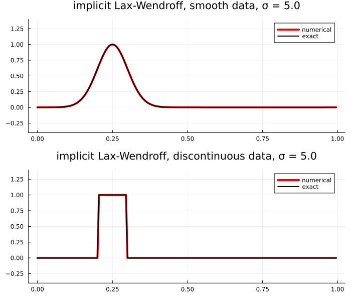

## MAM4 - EDP1
# 2026-27
# **TP 1 - Équation d'advection**

On résout numériquement l'équation d'advection sur $\Omega := ]0,1[$ avec conditions aux limites périodiques ($V > 0$) :

$$ \left\lbrace \begin{aligned}
& \frac{\partial u}{\partial t}(t,x) + V\frac{\partial u}{\partial x}(t,x) = 0,\quad x \in \Omega,\quad t > 0,\\
& u(t, 0) = u(t, 1),\quad t \ge 0,\\
& u(0, x) = u_0(x),\quad x \in \Omega.
\end{aligned} \right. $$

On suppose la donnée initiale $u_0$ $1$-périodique. On vérifie aisément que la solution exacte est donnée par $u(t,x) = u_0(x-Vt)$. On pose $t_n = n\Delta t$ et $x_j = j\Delta x$, et on note $u_j^n \simeq u(t_n,x_j)$.

**Conventions numériques.**

- *Maillage périodique.* On utilise $J$ points $x_j = j\Delta x$, $j = 0,\dots,J-1$, avec $\Delta x = 1/J$ (le point $x = 1$ n'est pas stocké : il est identifié à $x = 0$). La périodicité s'écrit $u_{-1} := u_{J-1}$ et $u_J := u_0$ ; en Julia, `circshift(u, 1)` donne $(u_{j-1})_j$ et `circshift(u, -1)` donne $(u_{j+1})_j$.
- *Temps final fixé.* On fixe le temps final $t_f$ et le nombre de pas de temps $N$ est déduit du nombre de Courant $\sigma = V\Delta t/\Delta x$ : on prend $\Delta t = t_f/N$ avec $N$ le plus petit entier tel que $\sigma$ effectif $\le \sigma$ demandé. Ainsi, **faire varier $\sigma$ ne change pas $t_f$** et les résultats sont comparables. Avec $V = 1$ et $t_f = 1$, la solution exacte à l'instant final est $u_0$ (une révolution).
- *Erreur.* On mesure l'erreur dans la norme $L^2$ discrète $\|u\|_2 = \big(\frac{1}{J}\sum_j u_j^2\big)^{1/2}$.
- *Deux données initiales* : une donnée lisse `u0_smooth` et une donnée discontinue `u0_disc` (créneau).

Le code ci-dessous (utilisé dans tous les exercices) est fourni ; il est à exécuter une fois en début de session. Les fonctions `solve`, `exact`, `err_L2` et `plot_result` n'ont pas à être modifiées. Dans les exercices, les parties marquées `# TBC` (*to be completed*) sont à compléter.

```julia
using LinearAlgebra, SparseArrays, Plots

# Problem data

V  = 1.0                                   # advection speed
tf = 1.0                                   # final time (one revolution, so u(tf, ·) = u0)

u0_smooth(x) = exp(-10 * (1 - cos(2π * (x - 0.25))))   # smooth, 1-periodic
u0_disc(x)   = Float64(0.2 < mod(x, 1) < 0.3)          # discontinuous, 1-periodic

datasets = [(u0_smooth, "smooth data"), (u0_disc, "discontinuous data")]

# Periodic grid: J points x_j = jΔx, j = 0, …, J-1, with Δx = 1/J

grid(J) = (0:J-1) / J

# Number of time steps N for a Courant number ≤ σ (tf is fixed, Δt = tf / N)

nsteps(J, σ) = ceil(Int, V * tf * J / σ - 1e-9)

# A scheme is a function (J, σ) -> (u -> next u).
# `solve` returns the numerical solution at tf, N and the effective Courant number

function solve(scheme, u0, J, σ)
    N = nsteps(J, σ)
    σe = V * (tf / N) * J
    step = scheme(J, σe)
    u = u0.(grid(J))
    for n in 1:N
        u = step(u)
    end
    return u, N, σe
end

exact(u0, J) = u0.(grid(J) .- V * tf)
err_L2(u, uex) = norm(u - uex) / sqrt(length(u))       # discrete L² norm on [0, 1)

function plot_result(x, u, uex; title = "")
    p1 = plot(x, u; color = :red, lw = 4, label = "numerical", ylabel = "u", title = title)
    plot!(p1, x, uex; color = :black, lw = 2, label = "exact")
    p2 = plot(x, u - uex; legend = false, xlabel = "x", ylabel = "error")
    return plot(p1, p2; layout = (2, 1), size = (700, 600))
end

# Run one case: plot the result and print the L² error

function run_case(scheme, u0, J, σ; name = "")
    u, N, σe = solve(scheme, u0, J, σ)
    display(plot_result(grid(J), u, exact(u0, J); title = "$name, σ = $(round(σe, digits = 3)), N = $N"))
    println("$name: J = $J, N = $N, σ = $σe, L² error = ", err_L2(u, exact(u0, J)))
end
```

## Exercice 1. Schéma décentré amont

On cherche à approcher la solution par le schéma *décentré amont* (*cf.* $V>0$) :

$$ \frac{u_j^{n+1}-u_j^n}{\Delta t} + V\frac{u_j^n-u_{j-1}^n}{\Delta x} = 0,\quad j = 0,\dots,J-1,\quad n \geq 0, $$

soit, en réarrangeant les termes,

$$ u_j^{n+1} = u_j^n - \sigma(u_j^n-u_{j-1}^n), $$

où $\sigma = V\Delta t/\Delta x$ est le [*nombre de Courant*](https://fr.wikipedia.org/wiki/Nombre_de_Courant), avec $u_j^0 = u_0(x_j)$.

```julia
# Upwind scheme (periodic): u_j^{n+1} = u_j^n - σ (u_j^n - u_{j-1}^n)

upwind(J, σ) = u -> u - σ * (u - circshift(u, 1))      # circshift(u, 1)[j] = u[j-1]

for (u0, data) in datasets
    run_case(upwind, u0, 200, 0.8; name = "upwind, $data")
end
```

**1.1** Exécuter le code, qui teste les deux données initiales (`u0_smooth` et `u0_disc`). Comparer les deux solutions numériques à la solution exacte.

**Réponse.** Pour $J = 200$ et $\sigma = 0.8$, l'erreur $L^2$ vaut $4.1\cdot 10^{-2}$ pour la donnée lisse et $1.2\cdot 10^{-1}$ pour le créneau. Le schéma amont ne produit pas d'oscillations : la solution numérique reste entre $0$ et $1$, mais le créneau est étalé (maximum $0.87$ au lieu de $1$) et la donnée lisse est atténuée.



**1.2** Augmenter progressivement $\sigma$ (par exemple $\sigma \in \{0.5, 0.9, 1, 1.05, 1.1\}$) et observer le résultat. Quelle est la valeur critique ? Que se passe-t-il pour $\sigma = 1$ ? Retrouver cette valeur par l'analyse de stabilité de Von Neumann (facteur d'amplification du schéma) et par un argument de domaine de dépendance (condition CFL).

**Réponse.** Le schéma est stable pour $\sigma \le 1$ et instable pour $\sigma > 1$ : le maximum de $|u|$ atteint $2.7$ pour $\sigma = 1.005$ (effectif), $2\cdot 10^{6}$ pour $\sigma \simeq 1.05$ et $10^{13}$ pour $\sigma \simeq 1.1$. Pour $\sigma = 1$, le schéma s'écrit $u_j^{n+1} = u_{j-1}^n$ : la solution est translée d'une maille par pas de temps, ce qui est exact (erreur nulle ici, car $Vt_f = 1$ correspond à $J$ mailles).

*Von Neumann.* Le facteur d'amplification est $a(\xi) = 1 - \sigma + \sigma e^{-i\varphi}$, avec $\varphi = 2\pi\xi\Delta x$, et
$$ |a(\xi)|^2 = 1 - 4\sigma(1-\sigma)\sin^2(\varphi/2), $$
qui est $\le 1$ pour tout $\varphi$ si et seulement si $0 \le \sigma \le 1$.

*CFL.* Le pied de la caractéristique, $x_j - V\Delta t$, doit appartenir au support de la formule, $[x_{j-1}, x_j]$, ce qui équivaut à $\sigma \le 1$.

**1.3** À $\sigma$ fixé, diminuer $J$ (par exemple $J \in \{50, 100, 200, 400\}$) et constater que la solution numérique est amortie au fil des itérations en temps (phénomène de *diffusion numérique*). Comment cet amortissement dépend-il de $J$ et de $\sigma$ ?

**Réponse.** Pour $\sigma = 0.8$, le maximum du créneau vaut $0.47$, $0.69$, $0.87$, $0.97$ pour $J = 50, 100, 200, 400$ : l'amortissement diminue quand $J$ augmente. À $J = 200$ fixé, il vaut $0.55$, $0.66$, $0.87$, $0.997$ pour $\sigma = 0.2, 0.5, 0.8, 0.95$, et il n'y en a plus pour $\sigma = 1$. Ce comportement est celui d'une équation de diffusion de coefficient $\nu_{\mathrm{num}} = V\Delta x(1-\sigma)/2$ (équation équivalente, voir 5.2) : l'étalement est de l'ordre de $\sqrt{2\nu_{\mathrm{num}}t_f}$, d'autant plus faible que $\Delta x$ est petit et $\sigma$ proche de $1$.

## Exercice 2. Schéma de Lax-Wendroff

En suivant le modèle précédent, implémenter le schéma

$$ u_j^{n+1} = u_j^n - \frac{\sigma}{2}(u_{j+1}^n - u_{j-1}^n) + \frac{\sigma^2}{2}(u_{j+1}^n - 2u_j^n + u_{j-1}^n),\quad j = 0,\dots,J-1,\quad n \geq 0. $$

```julia
# Explicit Lax-Wendroff scheme

lax_wendroff(J, σ) = u -> u - σ / 2 * (circshift(u, -1) - circshift(u, 1)) +
                       σ^2 / 2 * (circshift(u, -1) - 2u + circshift(u, 1))

for (u0, data) in datasets
    run_case(lax_wendroff, u0, 200, 0.8; name = "Lax-Wendroff, $data")
end
```

**2.1** Tester le schéma pour les deux données initiales, avec $\sigma = 0.8$. Quelles différences qualitatives observe-t-on avec le schéma décentré amont ? Quelle donnée initiale met le mieux en évidence ces différences ?

**Réponse.** Pour la donnée lisse, Lax-Wendroff est nettement plus précis : $4.7\cdot 10^{-3}$ contre $4.1\cdot 10^{-2}$ pour le schéma amont à $J = 200$. Pour le créneau, le front est plus raide mais des oscillations apparaissent derrière lui : la solution dépasse $1$ (maximum $1.19$) et devient négative (minimum $-0.19$), ce que le schéma amont ne fait pas. C'est la donnée discontinue qui met le mieux ces différences en évidence.



**2.2** Augmenter progressivement $\sigma$ et observer. Quelle est la valeur critique ?

**Réponse.** La valeur critique est encore $\sigma = 1$ : le maximum de $|u|$ est $6.6$ pour $\sigma \simeq 1.005$ et $1.6\cdot 10^{13}$ pour $\sigma \simeq 1.05$ ; pour $\sigma = 1$, le schéma est exact (il se réduit à $u_j^{n+1} = u_{j-1}^n$). Par Von Neumann, $|a(\xi)|^2 = 1 - 4\sigma^2(1-\sigma^2)\sin^4(\varphi/2)$, qui est $\le 1$ si et seulement si $\sigma \le 1$.

**2.3** Que peut-on dire de la diffusion numérique observée dans le cas du schéma décentré amont ? Le schéma de Lax-Wendroff est-il diffusif ? Quelle est la nature de l'erreur dominante ?

**Réponse.** La diffusion d'ordre $2$ (terme en $\Delta x$) du schéma amont est absente : le schéma est d'ordre $2$ et la donnée lisse n'est pas atténuée de façon visible. Il n'est pas pour autant sans dissipation : $|a(\xi)| < 1$ pour $0 < \sigma < 1$ et $\varphi \neq 0$, mais l'amortissement est d'ordre $4$ en $\Delta x$ (voir 5.3), donc négligeable pour les modes bien résolus. L'erreur dominante est de nature *dispersive* : les différentes fréquences ne sont pas transportées à la même vitesse, ce qui produit les oscillations derrière les discontinuités.

## Exercice 3. Schéma de Lax-Wendroff implicite

On modifie le schéma précédent en évaluant le terme de diffusion au temps $n+1$ :

$$ u_j^{n+1} = u_j^n - \frac{\sigma}{2}(u_{j+1}^n - u_{j-1}^n) + \frac{\sigma^2}{2}(u_{j+1}^{n+1} - 2u_j^{n+1} + u_{j-1}^{n+1}),\quad j = 0,\dots,J-1,\quad n \geq 0. $$

En introduisant $W^n := (u_j^n - (\sigma/2)(u_{j+1}^n - u_{j-1}^n))_j$ et $U^n := (u_j^n)_j$, le schéma s'écrit $AU^{n+1} = W^n$. La détermination de $U^{n+1}$ à partir de $U^n$ nécessite la résolution d'un système linéaire : on exploitera la structure creuse de $A$ et on la factorisera une seule fois, en dehors de la boucle en temps.

```julia
# Implicit Lax-Wendroff scheme: A U^{n+1} = W^n

function lax_wendroff_implicit(J, σ)
    A = spdiagm(-1 => fill(-σ^2 / 2, J - 1), 0 => fill(1 + σ^2, J), 1 => fill(-σ^2 / 2, J - 1))
    A[1, J] = -σ^2 / 2                                  # periodicity: corners
    A[J, 1] = -σ^2 / 2
    F = cholesky(A)                                     # SPD: factorised ONCE here (scheme(J, σ) is called before the time loop)
    return u -> F \ (u - σ / 2 * (circshift(u, -1) - circshift(u, 1)))   # time loop: only W^n and a back-substitution, no factorisation
end

J = 400
for (u0, data) in datasets, σ in [0.5, 1, 2, 5, 10, 20]
    u, N, σe = solve(lax_wendroff_implicit, u0, J, σ)
    println("$data, σ = $σ, N = $N, L² error: ", err_L2(u, exact(u0, J)))
end

for (u0, data) in datasets
    run_case(lax_wendroff_implicit, u0, J, 5.0; name = "implicit Lax-Wendroff, $data")
end
```

**3.1** Écrire la matrice $A$ ; justifier qu'elle est symétrique définie positive et préciser ses coins (périodicité). Compléter le code.

**Réponse.** Avec $S$ la matrice de décalage circulaire ($(SU)_j = U_{j-1}$),
$$ A = (1+\sigma^2) I - \frac{\sigma^2}{2}\left( S + S^\top \right), $$
c'est-à-dire une matrice tridiagonale de diagonale $1+\sigma^2$ et de sous- et sur-diagonales $-\sigma^2/2$, avec en plus les coins $A_{1,J} = A_{J,1} = -\sigma^2/2$ qui traduisent la périodicité. Elle est symétrique et à diagonale strictement dominante ($1 + \sigma^2 > \sigma^2$), donc définie positive (ses valeurs propres sont $\ge 1$) : la factorisation de Cholesky creuse s'applique, et elle est calculée une seule fois dans `lax_wendroff_implicit`.

**3.2** Que constate-t-on lorsque $\sigma$ dépasse $1$ ? Calculer le facteur d'amplification du schéma et conclure sur sa stabilité.

**Réponse.** Le schéma ne se dégrade pas brutalement pour $\sigma > 1$ : il n'y a pas d'explosion, même pour $\sigma = 20$. Le facteur d'amplification est
$$ a(\xi) = \frac{1 - i\sigma\sin\varphi}{1 + 2\sigma^2\sin^2(\varphi/2)}, \qquad |a(\xi)|^2 = \frac{1 + 4\sigma^2 s(1-s)}{(1 + 2\sigma^2 s)^2} = \frac{1 + 4\sigma^2 s - 4\sigma^2 s^2}{1 + 4\sigma^2 s + 4\sigma^4 s^2}, $$
avec $s = \sin^2(\varphi/2) \in [0,1]$, donc $|a(\xi)| \le 1$ pour tout $\xi$ et tout $\sigma > 0$ : le schéma est inconditionnellement stable au sens $L^2$. La valeur critique n'existe plus.

**3.3** Comment évolue l'erreur lorsque $\sigma$ augmente ? Pourquoi peut-on avoir à la fois stabilité et mauvaise précision ?

**Réponse.** L'erreur augmente fortement avec $\sigma$ : pour $J = 400$ et la donnée lisse, elle vaut $5.0\cdot 10^{-3}$, $9.8\cdot 10^{-3}$, $2.8\cdot 10^{-2}$, $0.11$, $0.19$, $0.24$ pour $\sigma = 0.5, 1, 2, 5, 10, 20$ (le maximum de la solution est à $0.48$ au lieu de $1$ pour $\sigma = 20$). Stabilité ne signifie pas précision : la stabilité borne la propagation des erreurs, mais n'améliore pas l'erreur de consistance, qui est ici de l'ordre de $\sigma^2\Delta x^2$ (par rapport au schéma explicite, le terme de diffusion est évalué en $t_{n+1}$ au lieu de $t_n$, ce qui introduit un terme en $\Delta t^2 u_{xxt}$). Pour $\sigma \gg 1$, $|a(\xi)|^2 \simeq 1/(\sigma^2 s)$ : tous les modes sauf les plus basses fréquences sont fortement amortis. Pour le créneau, l'erreur vaut $0.11$, $0.13$, $0.13$, $0.22$, $0.27$, $0.29$ ; le schéma oscille comme Lax-Wendroff explicite (maximum $1.25$ et minimum $-0.23$ pour $\sigma = 0.5$), puis la solution est écrasée pour $\sigma$ grand (maximum $0.39$ pour $\sigma = 20$).



## Exercice 4. Convergence et coût

**4.1 Ordre de convergence.** Compléter le code ci-dessous pour calculer l'erreur $L^2$ des trois schémas sur les maillages $J = 50, 100,\dots, 1600$ à $\sigma = 0.8$, et l'ordre observé (pente de la droite de régression de $\log(\text{erreur})$ en fonction de $\log \Delta x$). Commenter les ordres obtenus pour la donnée lisse puis pour la donnée discontinue.

```julia
Js = [50, 100, 200, 400, 800, 1600]
schemes = [("upwind", upwind), ("Lax-Wendroff", lax_wendroff), ("implicit LW", lax_wendroff_implicit)]

# L² errors on the successive grids (Courant number σ fixed)

function errors(scheme, u0; σ = 0.8)
    errs = Float64[]
    for J in Js
        u, = solve(scheme, u0, J, σ)
        push!(errs, err_L2(u, exact(u0, J)))
    end
    return errs
end

# Observed order: slope of the least squares line through the points (log Δx, log error)

function order(errs)
    A = [ones(length(Js)) log.(1 ./ Js)]
    return (A \ log.(errs))[2]
end

for (u0, name) in datasets
    p = plot(; xscale = :log10, yscale = :log10, xlabel = "Δx", ylabel = "L² error", title = name, legend = :bottomright)
    for (label, scheme) in schemes
        errs = errors(scheme, u0)
        plot!(p, 1 ./ Js, errs; marker = :o, label = "$label (order $(round(order(errs), digits = 2)))")
        println(name, ", ", label, ": observed order ", round(order(errs), digits = 2))
    end
    display(p)
end
```

**Réponse.** Les ordres observés (régression sur $J = 50,\dots,1600$) sont, pour la donnée lisse, $0.83$ (amont), $1.94$ (Lax-Wendroff) et $1.74$ (Lax-Wendroff implicite) : on retrouve les ordres $1$, $2$ et $2$ (le schéma implicite, à $\sigma$ fixé, est d'ordre $2$ ; l'écart avec $2$ vient du régime pré-asymptotique). Pour la donnée discontinue, les ordres chutent à $0.28$, $0.32$ et $0.35$ : la consistance suppose une solution régulière, et l'erreur est concentrée dans une couche de largeur $\Delta x^{1/2}$ (amont) ou $\Delta x^{2/3}$ (Lax-Wendroff) autour du front, ce qui donne en norme $L^2$ des ordres $1/4$ et $1/3$ respectivement. Dans ce cas la précision d'ordre $2$ ne sert presque à rien.

**4.2 Coût.** Le code suivant mesure, à $J = 400$ et pour la donnée lisse, le temps de calcul, le nombre de pas de temps et l'erreur. Discuter les performances relatives des schémas explicite et implicite. Pour atteindre une erreur $L^2$ donnée (par exemple $10^{-2}$), quel schéma est le moins coûteux ? On pourra adapter le code en faisant varier $J$.

```julia
# Computing time, number of steps and error

function timing(scheme, u0, J, σ)
    solve(scheme, u0, J, σ)                                        # compilation
    t = minimum(@elapsed(solve(scheme, u0, J, σ)) for _ in 1:3)
    u, N, σe = solve(scheme, u0, J, σ)
    return t, N, err_L2(u, exact(u0, J))
end

J = 400
for (label, scheme, σ) in [("LW", lax_wendroff, 0.9), ("implicit LW", lax_wendroff_implicit, 0.5),
                           ("implicit LW", lax_wendroff_implicit, 1.0), ("implicit LW", lax_wendroff_implicit, 2.0),
                           ("implicit LW", lax_wendroff_implicit, 5.0)]
    t, N, e = timing(scheme, u0_smooth, J, σ)
    println(rpad(label, 12), "σ = $σ, N = $N, time = $(round(1e3 * t, digits = 2)) ms, L² error = $e")
end
```

**Réponse.** À $J = 400$, le schéma de Lax-Wendroff explicite ($\sigma = 0.9$) atteint une erreur de $6.4\cdot 10^{-4}$ en environ $3$ ms ($445$ pas). Le schéma implicite à $\sigma = 0.5, 1, 2, 5$ donne $5.0\cdot 10^{-3}$, $9.8\cdot 10^{-3}$, $2.8\cdot 10^{-2}$, $0.11$ avec $800$, $400$, $200$, $80$ pas : un pas est plus coûteux (résolution d'un système) et grand $\sigma$ dégrade la précision (3.3). Pour une erreur de $10^{-2}$, on a besoin de $J = 200$ pour Lax-Wendroff explicite (environ $1$ ms), $J = 800$ pour le schéma amont (environ $4$ ms) et $J = 400$ pour le schéma implicite à $\sigma = 1$ (environ $6$ ms). Le schéma implicite n'est donc pas avantageux ici : l'explicite n'est limité que par $\sigma \le 1$, régime où il est le plus précis. L'implicite sert quand la stabilité impose un pas de temps beaucoup plus petit que ce que la précision demande (équations raides, par exemple la chaleur). Les temps dépendent de la machine et ne sont que des ordres de grandeur.

## Exercice 5 (bonus). Équation équivalente

**5.1** Implémenter le schéma explicite centré $u_j^{n+1} = u_j^n - \frac{\sigma}{2}(u_{j+1}^n - u_{j-1}^n)$ et le tester avec les deux données initiales pour plusieurs valeurs de $\sigma$. Que constate-t-on ? Expliquer par l'analyse de Von Neumann.

```julia
# Explicit centered scheme

centered(J, σ) = u -> u - σ / 2 * (circshift(u, -1) - circshift(u, 1))

J = 200
for (u0, data) in datasets, σ in [0.1, 0.5, 0.9]
    u, N, σe = solve(centered, u0, J, σ)
    println("$data, σ = $σ, N = $N, max |u| = ", maximum(abs.(u)))
end
```

**Réponse.** Le schéma est instable pour tout $\sigma > 0$ : après $t_f = 1$ et $J = 200$, pour la donnée lisse $\max|u|$ vaut $1.1$ pour $\sigma = 0.1$, $2.4\cdot 10^{3}$ pour $\sigma = 0.5$ et $3.7\cdot 10^{12}$ pour $\sigma = 0.9$ ; pour le créneau, qui contient des hautes fréquences, l'instabilité est déjà forte pour $\sigma = 0.1$ ($1.6\cdot 10^{3}$), et vaut $1.6\cdot 10^{18}$ et $2.4\cdot 10^{27}$ pour $\sigma = 0.5$ et $0.9$. Par Von Neumann, $a(\xi) = 1 - i\sigma\sin\varphi$ et $|a(\xi)|^2 = 1 + \sigma^2\sin^2\varphi > 1$ pour $\sin\varphi \neq 0$ : la croissance est lente pour $\sigma$ petit (la donnée lisse n'a presque pas de composante haute fréquence au départ), mais elle est inévitable.

**5.2** Par développement de Taylor, déterminer l'équation équivalente du schéma décentré amont, sous la forme $u_t + Vu_x = \nu\, u_{xx} + \dots$ Pour $u_0(x) = \sin(2\pi x)$, la solution de $u_t = \nu u_{xx}$ est amortie d'un facteur $e^{-\nu(2\pi)^2 t}$. Compléter le code pour comparer l'amortissement observé à l'amortissement prédit.

```julia
# Damping of u0(x) = sin(2πx) by the upwind scheme

u0_sin(x) = sin(2π * x)

for J in [50, 100, 200], σ in [0.5, 0.9]
    u, N, σe = solve(upwind, u0_sin, J, σ)
    ν = V / J * (1 - σe) / 2
    println("J = $J, σ = $σ: max u = ", maximum(u), ", predicted: ", exp(-ν * (2π)^2 * tf))
end
```

**Réponse.** Avec $\frac{u(t+\Delta t) - u(t)}{\Delta t} = u_t + \frac{\Delta t}{2}u_{tt} + \dots$, $\frac{u(x) - u(x-\Delta x)}{\Delta x} = u_x - \frac{\Delta x}{2}u_{xx} + \dots$ et $u_{tt} = V^2 u_{xx} + \dots$, on obtient
$$ u_t + Vu_x = \frac{V\Delta x}{2}(1 - \sigma)\, u_{xx} + O(\Delta x^2), \qquad \nu = \frac{V\Delta x}{2}(1-\sigma), $$
c'est le coefficient de diffusion numérique de 1.3, positif si et seulement si $\sigma < 1$ (c'est la condition de stabilité). Le maximum observé et le maximum prédit coïncident à $10^{-4}$ près pour $J \ge 100$ (par exemple $0.9060$ et $0.9060$ pour $J = 100$, $\sigma = 0.5$) et à $2\cdot 10^{-3}$ près pour $J = 50$ (où le mode $\sin(2\pi x)$ n'est résolu que par $50$ points).

**5.3** Écrire l'équation équivalente du schéma de Lax-Wendroff. Quel terme domine ? Interpréter les oscillations observées à l'exercice 2.

**Réponse.** On trouve
$$ u_t + Vu_x = -\frac{V\Delta x^2}{6}(1 - \sigma^2)\, u_{xxx} - \frac{V\Delta x^3}{8}\sigma(1-\sigma^2)\, u_{xxxx} + O(\Delta x^4). $$
Le terme dominant est le terme dispersif en $u_{xxx}$ : la vitesse de phase d'un mode de nombre d'onde $\kappa$ est $V - \frac{V\Delta x^2}{6}(1-\sigma^2)\kappa^2 < V$, donc les hautes fréquences sont en retard et forment les oscillations derrière le front. Le terme en $u_{xxxx}$ est dissipatif (signe négatif du second membre) mais d'ordre $\Delta x^3$ ; il n'amortit que les très hautes fréquences, d'où la persistance des oscillations.

## Annexe. Animations

La fonction suivante produit un GIF de l'évolution de la solution numérique (en rouge) et de la solution exacte (en noir), un panneau par schéma. Elle peut servir à visualiser les phénomènes observés.

```julia
# Animation: `cases` is a vector of (name, scheme, initial data), one panel per case

function animate(cases, J, σ; file = "evolution.gif", every = 4, fps = 15)
    x = grid(J)
    N = nsteps(J, σ)
    σe = V * (tf / N) * J
    steps = [scheme(J, σe) for (_, scheme, _) in cases]
    us = [u0.(x) for (_, _, u0) in cases]
    anim = Animation()
    for n in 0:N
        if n % every == 0
            panels = map(enumerate(cases)) do (k, (name, _, u0))
                p = plot(x, us[k]; color = :red, lw = 4, label = "numerical", ylims = (-0.4, 1.4), title = "$name, σ = $(round(σe, digits = 2))")
                plot!(p, x, u0.(x .- V * n * tf / N); color = :black, lw = 2, label = "exact")
            end
            frame(anim, plot(panels...; layout = (length(cases), 1), size = (700, 300 * length(cases))))
        end
        us = [steps[k](us[k]) for k in eachindex(cases)]
    end
    gif(anim, file; fps = fps)
end
```

Les GIF des exercices 1 à 3 sont générés par le code ci-dessous.

```julia
animate([("upwind, smooth data", upwind, u0_smooth), ("upwind, discontinuous data", upwind, u0_disc)], 200, 0.8; file = "transport_ex1.gif")
animate([("Lax-Wendroff, smooth data", lax_wendroff, u0_smooth), ("Lax-Wendroff, discontinuous data", lax_wendroff, u0_disc)], 200, 0.8; file = "transport_ex2.gif")
animate([("implicit Lax-Wendroff, smooth data", lax_wendroff_implicit, u0_smooth), ("implicit Lax-Wendroff, discontinuous data", lax_wendroff_implicit, u0_disc)], 200, 5.0; file = "transport_ex3.gif", every = 1)
```
