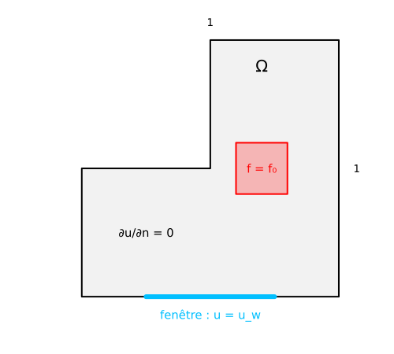
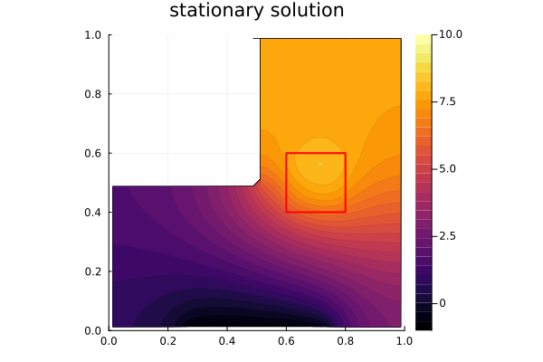
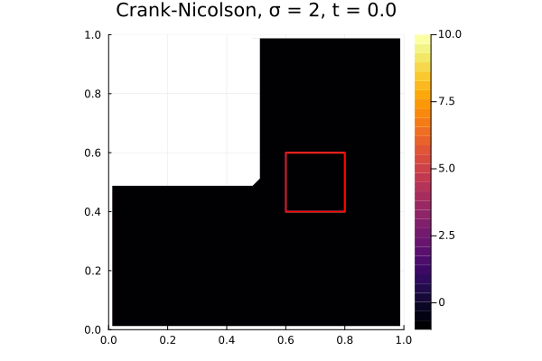

## MAM4 - EDP1
# **TP 2 - Équation de la chaleur : présentation**

## 1. Le problème

On simule la température $u(t,x,y)$ dans une pièce en forme de L, chauffée par un radiateur, dont les parois sont isolantes sauf une fenêtre.



- *Pièce.* $\Omega := ]0,1[^2 \setminus [0,\tfrac12]\times[\tfrac12,1]$ : le carré unité privé de son coin supérieur gauche. Le coin rentrant est en $(\tfrac12,\tfrac12)$.
- *Chauffage.* Source $f = f_0 = 250$ sur le carré $[0.6,0.8]\times[0.4,0.6]$, $f = 0$ ailleurs.
- *Paroi isolante.* Neumann homogène : $\dfrac{\partial u}{\partial n} = 0$ (aucun flux de chaleur à travers la paroi).
- *Fenêtre.* Sur $\{(x,0)\,;\ \tfrac14 \le x \le \tfrac34\}$ (mur du bas), la température est imposée : Dirichlet, $u = u_w = -1$.
- *Paramètres.* Diffusion $\nu = 1$, temps final $t_f = 4$, pièce initialement à la température de la fenêtre : $u_0 \equiv u_w$.

Deux types de conditions aux limites sur le même bord : ce mélange (Dirichlet-Neumann) est la difficulté « physique » du problème, et la raison pour laquelle la solution n'est pas régulière aux extrémités de la fenêtre et au coin rentrant.

## 2. Deux régimes

**Régime instationnaire (chaleur).** On cherche $u(t,x,y)$ avec
$$ \begin{aligned}
  & \frac{\partial u}{\partial t} - \nu\Delta u = f, \quad t > 0,\ (x,y) \in \Omega,\\
  & u(0,x,y) = u_0(x,y),\\
  & \frac{\partial u}{\partial n} = 0 \ \text{ sur les parois}, \qquad u = u_w \ \text{ sur la fenêtre}.
\end{aligned} $$

**Régime stationnaire (Poisson).** On cherche $u(x,y)$ indépendante du temps (équilibre : $\partial_t u = 0$) :
$$ -\nu\Delta u = f \ \text{ dans }\Omega, \qquad \frac{\partial u}{\partial n} = 0 \ \text{ (parois)}, \qquad u = u_w \ \text{ (fenêtre)}. $$
C'est un problème elliptique : un système linéaire $Au = b$ à résoudre. Le chauffage et la température de la fenêtre ne dépendent pas du temps, d'où le lien entre les deux régimes qu'on regardera aux questions 2.3 et 2.6.



*Plan du TP.* Exercice 1 : le problème stationnaire (assemblage, résolution, bilan d'énergie, convergence, validation). Exercice 2 : le problème instationnaire (schémas en temps, stabilité, ordre, pas de temps).

## 3. Différences finies sur une grille de cellules

On découpe $]0,1[^2$ en $N \times N$ cellules carrées de côté $h = 1/N$ ($N$ multiple de $20$) et l'on garde les cellules contenues dans $\Omega$. L'inconnue $u_k$ approche la température au centre de la cellule $k$ ; il y a $K$ cellules.

On intègre $-\nu\Delta u = f$ sur la cellule $k$ et l'on applique la formule de Green :
$$ -\nu\int_{\partial C_k}\frac{\partial u}{\partial n}\,d\gamma = \int_{C_k} f . $$
Le bord de la cellule est formé de quatre faces de longueur $h$. Pour une face commune avec la cellule voisine $l$, le flux est approché par $-\nu\,\dfrac{u_l - u_k}{h}\,h$. En divisant par $h^2$ :

- *cellule intérieure* (quatre voisines N, S, W, E dans $\Omega$) : le **schéma à 5 points**
$$ \frac{\nu}{h^2}\big(4u_k - u_{kN} - u_{kS} - u_{kW} - u_{kE}\big) = f_k ; $$
- *cellule au bord* : on tient compte de la condition aux limites (point 4 ci-dessous).

C'est le schéma des différences finies à 5 points, obtenu ici en intégrant sur la cellule : les conditions aux limites s'écrivent naturellement sur les flux.

## 4. La fonction `assemble`

On cherche la matrice $A \in \mathbf{R}^{K\times K}$ et le second membre $b \in \mathbf{R}^{K}$ tels que le schéma s'écrive $Au = b$ (ligne $k$ = équation de la cellule $k$). Deux points à bien comprendre.

### (i) Le terme général de la matrice et les conditions aux limites

*Terme général.* Pour la ligne $k$, on parcourt les quatre voisines. Pour chaque voisine $l$ qui est dans $\Omega$ :

- $A_{kl} = -\nu/h^2$ (coefficient hors diagonale),
- et l'on ajoute $\nu/h^2$ à la diagonale $A_{kk}$.

Une cellule intérieure a donc $A_{kk} = 4\nu/h^2$ et quatre coefficients $-\nu/h^2$ : c'est le schéma à 5 points. Le second membre contient la source : $b_k = f_k$.

*Neumann (parois).* Le flux à travers une paroi isolante est nul : le terme correspondant du schéma **n'existe pas**. Dans la ligne $k$, le voisin manquant ne donne ni coefficient hors diagonale ni contribution à la diagonale, et $b$ n'est pas modifié. Une cellule contre un mur a ainsi $A_{kk} = 3\nu/h^2$ (un seul mur) : la condition de Neumann est « absorbée » dans la matrice par l'absence des termes.

*Dirichlet (fenêtre).* La face de la fenêtre est à la température $u_w$, à la distance $h/2$ du centre de la cellule (et non $h$), d'où le flux $-\nu\,\dfrac{u_w - u_k}{h/2}\cdot h$ et, après division par $h^2$, le terme $\dfrac{2\nu}{h^2}(u_k - u_w)$. La donnée connue $u_w$ passe au second membre :

- on ajoute $2\nu/h^2$ à la diagonale $A_{kk}$,
- on ajoute $\dfrac{2\nu}{h^2}\,u_w$ à $b_k$.

*Bilan.* Neumann modifie **la matrice** (termes absents), Dirichlet modifie **la matrice et le second membre**. $A$ est symétrique ; elle est définie positive à cause de la fenêtre (sans elle, $A\mathbf{1} = 0$).

### (ii) Indices logiques et indices physiques : le rôle de `idx`

Deux façons de repérer une cellule :

- *indice physique* $(j,i)$ : $j$ = ligne = coordonnée en $y$, $i$ = colonne = coordonnée en $x$, centre $\big((i-\tfrac12)h,\ (j-\tfrac12)h\big)$. C'est le repérage naturel pour la géométrie et pour les dessins. Les tableaux `mask`, `win`, `f` (taille $N\times N$) sont indexés ainsi ;
- *indice logique* $k \in \{1,\dots,K\}$ : numéro de l'inconnue, position dans les vecteurs $u$, $b$ et dans les lignes et colonnes de $A$. Il n'y a que les cellules de $\Omega$ : on ne numérote pas le coin retiré.

Le tableau `idx` (taille $N\times N$) fait le lien : `idx[j,i]` est le numéro $k$ de la cellule $(j,i)$ (et `0` hors de $\Omega$). On le remplit par `idx[mask] = 1:K` : les cellules de $\Omega$ sont numérotées dans l'ordre de Julia, **colonne par colonne**. Une cellule voisine $n = c + \delta$ est dans $\Omega$ si `checkbounds(Bool, mask, n) && mask[n]`, et son numéro est `idx[n]`.

*Exemple miniature* ($N = 4$, coin $2\times 2$ retiré en haut à gauche, fenêtre sous les colonnes $2$ et $3$ ; $K = 12$). Valeurs de `idx[j,i]`, avec $y$ vers le haut :

| $j \backslash i$ | $1$ | $2$ | $3$ | $4$ |
|:-:|:-:|:-:|:-:|:-:|
| $4$ | · | · | $8$ | $12$ |
| $3$ | · | · | $7$ | $11$ |
| $2$ | $2$ | $4$ | $6$ | $10$ |
| $1$ | $1$ | $3$ *(fenêtre)* | $5$ *(fenêtre)* | $9$ |

- Cellule $k = 4$, en $(j,i) = (2,2)$ : voisines W $= 2$, E $= 6$, S $= 3$ ; la voisine N $(3,2)$ est hors de $\Omega$ (mur, Neumann). Ligne $4$ de $A$ : $A_{44} = 3\nu/h^2$ et $A_{42} = A_{43} = A_{46} = -\nu/h^2$.
- Cellule $k = 3$, en $(1,2)$ : voisines W $= 1$, E $= 5$, N $= 4$ ; au sud, la face de la fenêtre. Ligne $3$ : $A_{33} = 3\nu/h^2 + 2\nu/h^2 = 5\nu/h^2$ (trois voisines, plus Dirichlet), $A_{31} = A_{35} = A_{34} = -\nu/h^2$, et $b_3 = f_3 + \dfrac{2\nu}{h^2}u_w$.
- Pour revenir au dessin, `field(u, mask)` remet le vecteur $u$ dans un tableau $N\times N$ (avec `NaN` hors de $\Omega$) : $u_k \mapsto U[j,i]$ avec $k = $ `idx[j,i]`. Attention : pour tracer, `contourf(x, y, U)` attend `U[j,i]`, lignes $\leftrightarrow y$.

### Le code

Géométrie (la pièce, la fenêtre, le chauffage sont des tableaux $N\times N$) :

```julia
function lroom(N; heater = heater0)
    @assert N % 20 == 0
    mask = trues(N, N)
    mask[N÷2+1:N, 1:N÷2] .= false               # removed square
    win = falses(N, N)
    win[1, N÷4+1:3*N÷4] .= true                 # window: south wall, 1/4 ≤ x ≤ 3/4
    c = ((1:N) .- 0.5) / N                      # cell centres (in x and in y)
    (x0, x1), (y0, y1) = heater
    f = zeros(N, N)
    f[y0 .< c .< y1, x0 .< c .< x1] .= f0       # rows ↔ y, columns ↔ x
    @assert all(mask[f .> 0])                   # the heater must lie in Ω
    return mask, win, f
end
```

Assemblage :

```julia
# Finite difference assembly of A ≃ -νΔ and b (heating + Dirichlet data).
# Cells are numbered columnwise: idx[mask] = 1:K

function assemble(mask, win, f, h; ν = 1.0, uw = 0.0)
    K = count(mask)
    idx = zeros(Int, size(mask))
    idx[mask] = 1:K
    rows, cols, vals = Int[], Int[], Float64[]
    b = f[mask]                                 # new array
    for c ∈ findall(mask)                       # c = CartesianIndex(j, i)
        k = idx[c]
        d = 0.0
        for δ ∈ (CartesianIndex(0, -1), CartesianIndex(0, 1), CartesianIndex(-1, 0), CartesianIndex(1, 0))
            n = c + δ
            if checkbounds(Bool, mask, n) && mask[n]    # neighbour in Ω
                push!(rows, k); push!(cols, idx[n]); push!(vals, -ν / h^2)
                d += ν / h^2
            end                                          # else: insulating wall, no flux
        end
        if win[c]                                        # Dirichlet face at distance h/2
            d += 2ν / h^2
            b[k] += 2ν / h^2 * uw
        end
        push!(rows, k); push!(cols, k); push!(vals, d)
    end
    return sparse(rows, cols, vals, K, K), b, idx
end
```

Lecture du code :

- `mask`, `win`, `f` : cellules de $\Omega$, cellules touchant la fenêtre, source (tous indexés par $(j,i)$) ;
- `idx[mask] = 1:K` : numérotation logique des cellules de $\Omega$ ;
- `b = f[mask]` : le vecteur $(f_k)_k$, dans le même ordre que `idx` (indexation logique de Julia) ;
- boucle `for c ∈ findall(mask)` : une ligne de $A$ par cellule ; `k = idx[c]` ;
- boucle sur les quatre `δ` (W, E, S, N) : voisine dans $\Omega$ $\Rightarrow$ coefficient $-\nu/h^2$ et diagonale $+\nu/h^2$ ; sinon, rien (Neumann) ;
- `if win[c]` : Dirichlet, $+2\nu/h^2$ à la diagonale et $+2\nu/h^2\,u_w$ à $b_k$ ;
- `sparse(rows, cols, vals, K, K)` : on stocke les triplets (ligne, colonne, valeur) et l'on construit la matrice creuse (cinq coefficients non nuls par ligne au plus).

Puis `ustat = cholesky(Symmetric(A)) \ b` résout le problème stationnaire (factorisation de Cholesky, car $A$ est symétrique définie positive).

## 5. L'évolution en temps

On revient à $\partial_t u - \nu\Delta u = f$. Après la même discrétisation en espace, on obtient le système différentiel
$$ \frac{du}{dt} + A u = b, \qquad u(0) = (u_w,\dots,u_w), $$
avec **les mêmes $A$ et $b$** que pour le problème stationnaire : les conditions aux limites sont déjà dans $A$ (Neumann : termes absents ; Dirichlet : diagonale) et dans $b$ (Dirichlet) ; le terme en temps n'ajoute que l'identité. (Cela suppose $f$ et $u_w$ indépendants du temps, comme ici.)

On discrétise en temps par le $\theta$-schéma, avec $\Delta t$ le pas de temps :
$$ \frac{u^{n+1} - u^n}{\Delta t} + A\big(\theta u^{n+1} + (1-\theta)u^n\big) = b \iff (I + \theta\Delta t\,A)\,u^{n+1} = \big(I - (1-\theta)\Delta t\,A\big)u^n + \Delta t\,b. $$

- $\theta = 0$ : explicite ; $\theta = 1$ : Euler implicite ; $\theta = \tfrac12$ : Crank-Nicolson.
- La matrice $I + \theta\Delta t\,A$ est symétrique définie positive et ne change pas d'un pas à l'autre : on la factorise **une seule fois** (`cholesky`), puis chaque pas coûte une résolution.
- On pilote le pas de temps par $\sigma := \nu\Delta t/h^2$ ; le temps final $t_f$ est fixé.



Dans le TP, vous complétez la fonction `evolve` (les `# TBC`), puis vous étudiez la stabilité, l'ordre en temps et le comportement pour de grands pas de temps. Pour le schéma explicite, observez ce qui se passe quand $\sigma$ augmente.

## 6. Stabilité : analyse exacte sur la matrice

*Question.* À $\Delta t$ fixé, une petite perturbation des données (arrondis, erreur sur $u^0$) est-elle amplifiée au cours des pas de temps ? Cela dépend de $\theta$ et de $\sigma$.

**Les conditions aux limites sont dans la matrice.** Si $u^n$ et $\tilde u^n$ sont deux solutions du schéma issues de deux données initiales proches, la différence $e^n := \tilde u^n - u^n$ vérifie, par linéarité (les mêmes $A$ et $b$ sont utilisés et $b$ disparaît dans la différence),
$$ e^{n+1} = G\,e^n, \qquad G := (I + \theta\Delta t\,A)^{-1}\big(I - (1-\theta)\Delta t\,A\big). $$
La stabilité est donc celle de la matrice $G$, qui contient les conditions aux limites (Neumann dans la structure de $A$, Dirichlet dans sa diagonale) et la géométrie de la pièce.

**Décomposition sur les vecteurs propres.** $A$ est symétrique définie positive : il existe une base orthonormée de vecteurs propres $v_1,\dots,v_K$, avec $Av_j = \lambda_j v_j$ et $0 < \lambda_1 \le \dots \le \lambda_K$. On décompose la perturbation initiale $e^0 = \sum_j c_j v_j$. Chaque $v_j$ est un vecteur propre de $G$ :
$$ G v_j = a(\lambda_j)\,v_j, \qquad a(\lambda) := \frac{1 - (1-\theta)\Delta t\,\lambda}{1 + \theta\Delta t\,\lambda}, $$
donc, composante par composante (chaque direction propre évolue indépendamment des autres),
$$ e^n = \sum_{j=1}^K c_j\,a(\lambda_j)^n\,v_j, \qquad \|e^n\|^2 = \sum_{j=1}^K c_j^2\,a(\lambda_j)^{2n}\quad\Big(\text{norme } \|e\|^2 = h^2\textstyle\sum_k e_k^2\Big). $$
Le schéma est donc stable pour la norme $\ell^2$ (c'est-à-dire $\|e^n\| \le \|e^0\|$ pour toute perturbation) **si et seulement si**
$$ |a(\lambda_j)| \le 1 \quad \text{pour tout } j = 1,\dots,K. $$
Il n'y a pas de constante : comme $A$ est symétrique (donc normale), $\|G\|_2 = \max_j |a(\lambda_j)|$ exactement. La condition est nécessaire et suffisante, pour ce problème précis (ce domaine, ces conditions aux limites, ce maillage).

**Les trois schémas.** Avec $\lambda = \lambda_j > 0$ :

| schéma | $a(\lambda)$ | $\lvert a\rvert \le 1$ pour tout $j$ ? | limite $\Delta t\lambda \to \infty$ |
|:-:|:-:|:-:|:-:|
| explicite ($\theta = 0$) | $1 - \Delta t\,\lambda$ | si et seulement si $\Delta t\,\lambda_K \le 2$ | instable |
| Euler implicite ($\theta = 1$) | $\dfrac{1}{1 + \Delta t\,\lambda} \in ]0,1[$ | toujours | $\to 0$ |
| Crank-Nicolson ($\theta = \tfrac12$) | $\dfrac{1 - z}{1 + z}$, $z = \dfrac{\Delta t\,\lambda}{2}$ | toujours ($\lvert a\rvert < 1$ car $z > 0$) | $\to -1$ |

Le schéma explicite est stable sous condition : c'est le mode de plus grande valeur propre $\lambda_K$ qui est le plus exigeant.

**Où est $\lambda_K$ ?** Sur la pièce en L avec conditions mixtes, les valeurs propres de $A$ ne sont pas explicites. On se contente d'une borne : le lemme de Gershgorin (à redémontrer en question 2.2) donne $\lambda_K \le 8\nu/h^2$. Il en résulte
$$ \Delta t\,\lambda_K \le 8\sigma \le 2 \quad\Longleftarrow\quad \sigma = \frac{\nu\Delta t}{h^2} \le \frac14 . $$
La borne est presque atteinte (pour $N = 40$, $\lambda_K = 12775$ pour $8\nu/h^2 = 12800$) : la condition $\sigma \le 1/4$ est donc quasiment nécessaire. Le mode correspondant est celui qui oscille d'une cellule à l'autre (en damier), et c'est bien lui qu'on voit exploser pour $\sigma = 0.26$.

**Ce que dit le spectre en plus.** La plus petite valeur propre $\lambda_1 > 0$ (elle est strictement positive grâce à la fenêtre de Dirichlet) fixe la vitesse à laquelle $u(t)$ approche l'état stationnaire, en $e^{-\lambda_1 t}$ (question 2.3). Et pour Crank-Nicolson, $a(\lambda) \to -1$ quand $\Delta t\lambda \to \infty$ : les modes raides ne sont pas amortis, ils changent de signe à chaque pas (question 2.6), contrairement à Euler implicite.

**Comparaison avec l'analyse de von Neumann.** Les deux analyses utilisent le même facteur $a(\lambda)$, sur des spectres différents.

- *von Neumann* est a priori : maillage uniforme, coefficients constants, domaine périodique ou infini. Les modes sont des exponentielles $e^{i(k_x x + k_y y)}$ et $\lambda(k) = \frac{4\nu}{h^2}\big(\sin^2\frac{k_xh}{2} + \sin^2\frac{k_yh}{2}\big) \in [0, 8\nu/h^2]$ : on retrouve la même condition $\sigma \le 1/4$, mais sans voir les conditions aux limites ni la forme de la pièce.
- *L'analyse de la matrice* est exacte pour le problème posé, bords compris : le spectre est celui de $A$. Ses plus grandes valeurs propres sont locales et presque insensibles aux bords (d'où le même résultat), alors que les plus petites en dépendent ($\lambda_1 > 0$ ici, alors que la version périodique a le mode constant $\lambda = 0$).
- *Limite.* L'égalité $\|G\|_2 = \max_j|a(\lambda_j)|$ vient de la symétrie de $A$. Pour un problème non symétrique (l'advection du TP 1), le spectre ne suffit plus et von Neumann reste l'outil de base.

## 7. Organisation du TP

- Le code de départ (géométrie, `assemble`, début de `evolve`) est dans le [sujet](tp2.md) ; il est à exécuter une fois en début de session, puis à compléter pour les `# TBC`.
- Julia : paquets `SparseArrays`, `LinearAlgebra` et `Plots`.
- Les questions de l'exercice 1 se traitent dans l'ordre : assemblage, résolution, bilan d'énergie, déplacement du chauffage, validation sur un cas test, convergence en espace.
- Les questions de l'exercice 2 : schéma de Crank-Nicolson et conditions aux limites, stabilité, programmation de `evolve`, schéma explicite, ordre en temps, grand pas de temps.
- Points d'attention : repérage $(j,i)$ = (ligne en $y$, colonne en $x$) ; ne pas confondre indice physique et indice logique ; le coefficient de Dirichlet est $2\nu/h^2$ (distance $h/2$) ; les tracés sont faits par `heatplot`.
