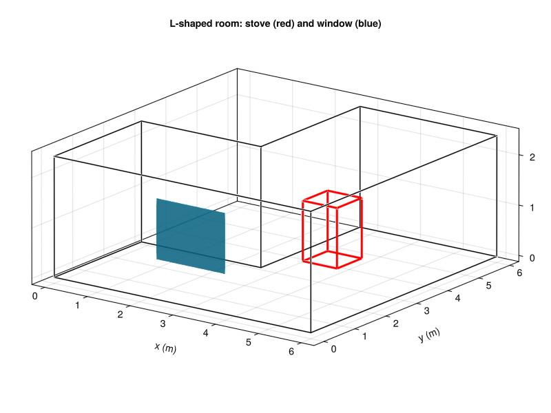

## MAM4 - EDP1
# 2026-27
# **TP 2 bis - Équation de la chaleur en 3D**

On reprend le TP 2 dans une vraie pièce en trois dimensions, avec des dimensions réalistes. On souhaite simuler l'évolution de la température dans une pièce en forme de L
- chauffée par un poêle situé dans la partie nord de la pièce (à l'ordonnée réduite $0.6$ à $0.8$, comme dans le TP 2),
- dont les parois, le sol et le plafond sont isolants,
- à l'exception d'une fenêtre située sur le mur du bas (mur sud), à une hauteur réaliste.

La température suit l'EDP de la chaleur 3D :

$$ \begin{aligned}
  & \frac{\partial u}{\partial t} - \nu\Delta u = f,\quad t > 0,\quad (x,y,z) \in \Omega,\\
  & u(0,x,y,z) = u_0,\quad  (x,y,z) \in \Omega,
\end{aligned} $$

avec des conditions aux limites appropriées sur le bord du domaine.

**Le problème.** Les longueurs sont en mètres, les températures en °C, le temps en secondes.



- *Pièce.* Le plan est le carré $]0,6[^2$ privé du bloc $[0,2.8]\times[2.8,6]$ (une aile sud de $6 \times 2.8$ m et une aile est de $3.2 \times 3.2$ m, soit $27$ m² au sol), et la hauteur sous plafond est $H = 2.4$ m. Sur les parois, le sol et le plafond, la condition est de Neumann homogène (isolation) :
$$ \frac{\partial u}{\partial n} = 0. $$
- *Fenêtre.* Elle est sur le mur sud $y = 0$, pour $2.4 \le x \le 4$ (largeur $1.6$ m) et $0.8 \le z \le 2$ (hauteur $1.2$ m) : l'allège (hauteur du bas de la fenêtre) est de $0.8$ m et le haut est à $2$ m, ce qui correspond à des valeurs usuelles dans le bâtiment (allège de $0.8$ à $1$ m, haut à hauteur de porte). Sur la fenêtre, la température est imposée (Dirichlet inhomogène) : $u = u_w = 0$ °C.
- *Poêle.* Un poêle de $0.8 \times 0.8$ m au sol et $1.2$ m de haut, occupant $[3.2,4]\times[3.6,4.4]\times[0,1.2]$. Son ordonnée correspond à la plage $[0.6,0.8]$ du TP 2 ramenée à la profondeur de $6$ m de la pièce ($[3.6,4.8]$ m), et il est dans l'aile est, à $0.4$ m du mur intérieur. Il fournit une puissance $P = 1200$ W, répartie uniformément dans son volume $V$ : $f = P/(\rho c_p V)$ dans le poêle, $f = 0$ ailleurs, avec $\rho c_p \simeq 1.2\cdot10^3$ J/(m³ K) pour l'air.
- *Diffusion.* On prend $\nu = 0.02$ m²/s. C'est une diffusivité *effective* qui modélise le brassage de l'air par de faibles mouvements de convection : la valeur moléculaire de l'air ($2\cdot10^{-5}$ m²/s) donnerait des temps caractéristiques de plusieurs semaines pour une pièce de cette taille. C'est donc un modèle simplifié (pas de flottabilité : l'air chaud ne monte pas, il n'y a pas de stratification).
- *Condition initiale.* La pièce est à $u_0 = 10$ °C. Le temps final est $t_f = 2$ h $= 7200$ s.

**Conventions numériques.**

- *Maillage en cellules.* On découpe la boîte $]0,6[^2\times]0,H[$ en cellules cubiques de côté $h$ (un diviseur commun de toutes les dimensions, par exemple $h = 0.4,\ 0.2,\ 0.1$ m) et l'on garde les cellules contenues dans $\Omega$. L'inconnue $u_k$ approche la température au centre de la cellule $k$. En Julia, la cellule $(i,j,k)$ est repérée par ses indices en $x$, $y$ et $z$.
- *Différences finies.* On intègre $-\nu\Delta u = f$ sur chaque cellule : le flux à travers une face commune à deux cellules voisines est approché par $-\nu(u_l - u_k)/h$, un mur isolant ne donne aucun flux, et une face de la fenêtre est à la température $u_w$, à distance $h/2$ du centre de la cellule.
- *Pas de temps.* On fixe le pas de temps $\Delta t$ (en secondes), et on pose $\sigma := \nu\Delta t/h^2$.
- *Distance à l'état stationnaire.* On mesure la distance entre deux champs par l'écart quadratique moyen $\|u\| := \big(\frac{1}{K}\sum_k u_k^2\big)^{1/2}$ (en °C), où $K$ est le nombre de cellules.

Le code ci-dessous est à exécuter une fois en début de session. La visualisation utilise Makie (paquet `GLMakie`) : trois coupes de la température en contours remplis (`contourf!`) : une coupe horizontale à $1$ m de hauteur et deux coupes verticales passant par le poêle (en rouge) ; la fenêtre est en bleu et les cellules hors de la pièce sont en blanc. Une vue 3D (rendu volumique, `volume3d`) représente la chaleur comme un gaz coloré.

```julia
using SparseArrays, LinearAlgebra

# Physical data (SI units, temperatures in °C)

ν  = 0.02            # effective diffusivity of the air, m²/s
uw = 0.0             # window temperature
u0 = 10.0            # initial temperature of the room
P  = 1200.0          # stove power, W
ρc = 1.2 * 1005      # volumetric heat capacity ρ c_p of air, J/(m³ K)
tf = 7200.0          # final time: 2 h

# Geometry (m). Plan: ]0,6[² minus the block [0,2.8]×[2.8,6]; height H.
# Each range is (min, max); the window is on the south wall y = 0.

H      = 2.4
corner = ((0.0, 2.8), (2.8, 6.0))                # removed block: x-range, y-range
window = ((2.4, 4.0), (0.8, 2.0))                # x-range, z-range (sill 0.8 m, top 2.0 m)
stove0 = ((3.2, 4.0), (3.6, 4.4), (0.0, 1.2))    # x-, y-, z-ranges

# Cells of size h (h must divide all the dimensions above). Cell (i, j, k): x, y, z.
# Returns: mask (cells in the room), win (cells touching the window), f (heating, K/s)

function room(h; stove = stove0)
    function cells(r)
        a, b = r ./ h
        @assert abs(a - round(a)) < 1e-8 && abs(b - round(b)) < 1e-8 "h must divide the dimensions"
        return (round(Int, a) + 1):round(Int, b)
    end
    Nx, Ny, Nz = round.(Int, (6.0, 6.0, H) ./ h)
    mask = trues(Nx, Ny, Nz)
    mask[cells(corner[1]), cells(corner[2]), :] .= false
    win = falses(Nx, Ny, Nz)
    win[cells(window[1]), 1, cells(window[2])] .= true
    f = zeros(Nx, Ny, Nz)
    V = prod(r[2] - r[1] for r ∈ stove)          # volume of the stove, m³
    f[cells(stove[1]), cells(stove[2]), cells(stove[3])] .= P / (ρc * V)
    return mask, win, f
end

# Cell values (vector) → 3D array with NaN outside the room

field(u, mask) = (U = fill(NaN, size(mask)); U[mask] = u; U)
```

```julia
using GLMakie

# Room outline, stove (red edges) and window (blue)

function box!(ax, (x0, x1), (y0, y1), (z0, z1); kw...)
    P = [Point3f(x, y, z) for x ∈ (x0, x1), y ∈ (y0, y1), z ∈ (z0, z1)]
    for (a, b) ∈ ((1, 2), (3, 4), (5, 6), (7, 8), (1, 3), (2, 4), (5, 7), (6, 8), (1, 5), (2, 6), (3, 7), (4, 8))
        lines!(ax, [P[a], P[b]]; kw...)
    end
end

function draw_room!(ax; stove = stove0, overdraw = false)
    poly = [(0.0, 0.0), (6.0, 0.0), (6.0, 6.0), (corner[1][2], 6.0), (corner[1][2], corner[2][1]), (0.0, corner[2][1])]
    for z ∈ (0.0, H)
        lines!(ax, [Point3f(x, y, z) for (x, y) ∈ [poly; poly[1]]]; color = :black, overdraw = overdraw)
    end
    for (x, y) ∈ poly
        lines!(ax, [Point3f(x, y, 0), Point3f(x, y, H)]; color = :black, overdraw = overdraw)
    end
    box!(ax, stove...; color = :red, linewidth = 3, overdraw = overdraw)
    (x0, x1), (z0, z1) = window
    mesh!(ax, Rect3f(Vec3f(x0, -0.01, z0), Vec3f(x1 - x0, 0.02, z1 - z0)); color = (:deepskyblue, 0.6), transparency = true)
end

# Filled contour plots of three orthogonal slices of the temperature U (an Observable 3D array,
# NaN outside the room); cells outside the room are drawn in white

levels = range(0, 42, length = 15)          # one contour every 3 °C
nanfill(A) = map(a -> isnan(a) ? -1.0 : a, A)

function scene3d(U, x, y, z, title; stove = stove0, at = (3.6, 4.0, 1.0))
    i, j, k = [argmin(abs.(c .- a)) for (c, a) ∈ zip((x, y, z), at)]
    (sx, sy, sz), (wx, wz) = stove, window
    kw = (colormap = :inferno, levels = levels, extendlow = :white, extendhigh = :auto)
    fig = Figure(size = (1250, 400))
    Label(fig[0, 1:3], title; fontsize = 18, font = :bold)
    # (a) horizontal slice z = at[3]
    ax1 = Axis(fig[1, 1]; aspect = DataAspect(), xlabel = "x (m)", ylabel = "y (m)", title = "horizontal slice, z = $(at[3]) m")
    co = contourf!(ax1, x, y, lift(U -> nanfill(U[:, :, k]), U); kw...)
    poly = [(0.0, 0.0), (6.0, 0.0), (6.0, 6.0), (corner[1][2], 6.0), (corner[1][2], corner[2][1]), (0.0, corner[2][1]), (0.0, 0.0)]
    lines!(ax1, Point2f.(poly); color = :black)
    lines!(ax1, Point2f.([(sx[1], sy[1]), (sx[2], sy[1]), (sx[2], sy[2]), (sx[1], sy[2]), (sx[1], sy[1])]); color = :red, linewidth = 2)
    lines!(ax1, [Point2f(wx[1], 0), Point2f(wx[2], 0)]; color = :deepskyblue, linewidth = 5)
    # (b) vertical slice y = at[2], through the stove
    ax2 = Axis(fig[1, 2]; aspect = DataAspect(), xlabel = "x (m)", ylabel = "z (m)", title = "vertical slice, y = $(at[2]) m")
    contourf!(ax2, x, z, lift(U -> nanfill(U[:, j, :]), U); kw...)
    lines!(ax2, Point2f.([(sx[1], sz[1]), (sx[2], sz[1]), (sx[2], sz[2]), (sx[1], sz[2]), (sx[1], sz[1])]); color = :red, linewidth = 2)
    # (c) vertical slice x = at[1], through the stove and the window
    ax3 = Axis(fig[1, 3]; aspect = DataAspect(), xlabel = "y (m)", ylabel = "z (m)", title = "vertical slice, x = $(at[1]) m")
    contourf!(ax3, y, z, lift(U -> nanfill(U[i, :, :]), U); kw...)
    lines!(ax3, Point2f.([(sy[1], sz[1]), (sy[2], sz[1]), (sy[2], sz[2]), (sy[1], sz[2]), (sy[1], sz[1])]); color = :red, linewidth = 2)
    lines!(ax3, [Point2f(0, wz[1]), Point2f(0, wz[2])]; color = :deepskyblue, linewidth = 5)
    Colorbar(fig[1, 4], co; label = "temperature (°C)")
    return fig, (ax1, ax2, ax3)
end

# 3D view: the heat is seen as a coloured gas (volume rendering). Cells at u₀ = 10 °C or colder are
# transparent; the hotter the cell, the brighter and the more opaque. U is an Observable 3D array.

const cmap = Makie.to_colormap(:inferno)
function heatgas(u; ulow = u0, uhigh = 42.0)
    isnan(u) && return RGBAf(0, 0, 0, 0)
    s = clamp((u - ulow) / (uhigh - ulow), 0, 1)
    c = cmap[1 + round(Int, s * (length(cmap) - 1))]
    return RGBAf(c.r, c.g, c.b, s)
end

function volume3d(U, title; stove = stove0)
    fig = Figure(size = (800, 600))
    ax = Axis3(fig[1, 1]; aspect = :data, azimuth = 1.7π, elevation = 0.35, title = title,
               xlabel = "x (m)", ylabel = "y (m)", zlabel = "z (m)")
    volume!(ax, (0, 6), (0, 6), (0, H), lift(U -> heatgas.(U), U); algorithm = :absorptionrgba, absorption = 5.0f0)
    draw_room!(ax; stove = stove, overdraw = true)    # edges drawn on top of the gas
    Colorbar(fig[1, 2]; colormap = :inferno, limits = (u0, 42), label = "temperature (°C), transparent at u₀ = 10 °C")
    return fig, ax
end
```

## Exercice 1

On commence par le problème stationnaire (Poisson) : trouver $u$ telle que $-\nu\Delta u = f$ dans $\Omega$ avec les conditions aux limites ci-dessus. Le code suivant assemble la matrice $A$ et le second membre $b$ du système linéaire $Au = b$.

```julia
# Finite difference assembly of A ≃ -νΔ and b (heating + Dirichlet data): 7-point stencil.
# Cells are numbered with idx[mask] = 1:K (x runs fastest)

function assemble(mask, win, f, h; ν = 1.0, uw = 0.0)
    K = count(mask)
    idx = zeros(Int, size(mask))
    idx[mask] = 1:K
    rows, cols, vals = Int[], Int[], Float64[]
    b = f[mask]                                        # new array
    nbrs = (CartesianIndex(-1, 0, 0), CartesianIndex(1, 0, 0), CartesianIndex(0, -1, 0),
            CartesianIndex(0, 1, 0), CartesianIndex(0, 0, -1), CartesianIndex(0, 0, 1))
    for c ∈ findall(mask)                              # c = CartesianIndex(i, j, k)
        k = idx[c]
        d = 0.0
        for δ ∈ nbrs
            n = c + δ
            if checkbounds(Bool, mask, n) && mask[n]   # neighbour in the room
                push!(rows, k); push!(cols, idx[n]); push!(vals, -ν / h^2)
                d += ν / h^2
            end                                        # else: insulating wall, no flux
        end
        if win[c]                                      # Dirichlet face at distance h/2
            d += 2ν / h^2
            b[k] += 2ν / h^2 * uw
        end
        push!(rows, k); push!(cols, k); push!(vals, d)
    end
    return sparse(rows, cols, vals, length(b), length(b)), b, idx
end

h = 0.2
mask, win, f = room(h)
A, b, idx = assemble(mask, win, f, h; ν = ν, uw = uw)
K = size(A, 1)
x, y, z = [((1:n) .- 0.5) * h for n ∈ size(mask)]    # cell centres

# Stationary solution: -νΔu = f (A is symmetric positive definite)

ustat = cholesky(Symmetric(A)) \ b
@show K extrema(ustat) sum(ustat) / K
```

**1.1** Montrer que, pour une cellule $k$, la ligne $k$ du système s'écrit
$$ \frac{\nu}{h^2}\Big( n_k u_k - \sum_{l \sim k} u_l \Big) + \frac{2\nu}{h^2}\,u_k\,\mathbf{1}_{k \in W} = f_k + \frac{2\nu}{h^2}\,u_w\,\mathbf{1}_{k \in W}, $$
où $l \sim k$ désigne les cellules voisines de $k$ *dans* $\Omega$ (au plus six), $n_k$ leur nombre et $W$ l'ensemble des cellules de la fenêtre. En déduire que $A$ est symétrique définie positive.

**1.2** Vérifier numériquement, puis démontrer au niveau discret, le bilan d'énergie : la puissance du poêle $\rho c_p h^3\sum_k f_k$ est égale au flux de chaleur sortant par la fenêtre $\rho c_p h^3\sum_{k\in W}\frac{2\nu}{h^2}(u_k - u_w)$.

```julia
# Energy balance: stove power = heat flux through the window (in W)

power = ρc * h^3 * sum(f)
flux  = ρc * h^3 * sum(2ν / h^2 * (ustat[idx[win]] .- uw))
@show power flux
```

**1.3** Tracer la solution stationnaire (contours remplis sur trois coupes). Commenter les températures observées : maximum, minimum, moyenne, et température loin du poêle.

```julia
# Contour plots of the stationary temperature (move the stove with room(h; stove = ...))

fig, _ = scene3d(Observable(field(ustat, mask)), x, y, z, "stationary solution")
display(fig)
```

**1.4** Déplacer le poêle (argument `stove` de `room`, par exemple $[3.2,4]\times[0.4,1.2]\times[0,1.2]$, près de la fenêtre, puis $[4.8,5.6]\times[4.4,5.2]\times[0,1.2]$, au fond de l'aile est), à puissance égale. Que deviennent les températures moyenne et maximale ? Le bilan d'énergie change-t-il ?

**1.5** *Validation.* Pour vérifier le code d'assemblage 3D, on prend le cube $]0,1[^3$ avec $u = 0$ sur toute la face du bas et Neumann ailleurs, et $f(x,y,z) = \nu\frac{\pi^2}{4}\sin\big(\frac{\pi z}{2}\big)$. Donner la solution exacte, puis calculer l'erreur maximale pour $N = 8, 16, 32$ cellules par côté et en déduire l'ordre observé.

```julia
# Validation: unit cube, u = 0 on the whole bottom face, Neumann elsewhere,
# f = (π²/4) sin(πz/2) (ν = 1); exact solution u = sin(πz/2)

function test_cube(N)
    h = 1 / N
    mask = trues(N, N, N)
    win = falses(N, N, N)
    win[:, :, 1] .= true
    z = ((1:N) .- 0.5) * h
    f = repeat(reshape(π^2 / 4 * sin.(π * z / 2), 1, 1, N), N, N, 1)
    A, b, _ = assemble(mask, win, f, h)                # ν = 1, uw = 0
    u = cholesky(Symmetric(A)) \ b
    return maximum(abs.(u - vec(repeat(reshape(sin.(π * z / 2), 1, 1, N), N, N, 1))))
end

for N ∈ (8, 16, 32)
    println("N = $N: max error = $(test_cube(N))")
end
```

**1.6** *Convergence et coût sur la pièce.* Pour $h = 0.4,\ 0.2,\ 0.1$, calculer le nombre d'inconnues $K$, la température moyenne et maximale, et le nombre de coefficients non nuls de $A$ et de son facteur de Cholesky $L$. Quel ordre observe-t-on ? Estimer le coût mémoire pour $h = 0.05$.

```julia
# Convergence on the room: mean and maximum temperature, size of the factors

function steady(h)
    mask, win, f = room(h)
    A, b, idx = assemble(mask, win, f, h; ν = ν, uw = uw)
    F = cholesky(Symmetric(A))
    u = F \ b
    return size(A, 1), sum(u) / size(A, 1), maximum(u), nnz(A), nnz(sparse(F.L))
end

for h ∈ (0.4, 0.2, 0.1)
    K, m, M, nA, nL = steady(h)
    println("h = $h: K = $K, mean = $m, max = $M, nnz(A) = $nA, nnz(L) = $nL")
end
```

## Exercice 2

On calcule maintenant l'évolution temporelle de la température, avec le $\theta$-schéma
$$ (I + \theta\Delta t\,A)\,u^{n+1} = \big(I - (1-\theta)\Delta t\,A\big)u^n + \Delta t\,b, $$
où $A$ et $b$ sont ceux de l'exercice 1. Le cas $\theta = 0$ est le schéma explicite, $\theta = 1$ le schéma d'Euler implicite et $\theta = \tfrac12$ le schéma de Crank-Nicolson.

**2.1** *Stabilité.* Montrer que, comme en 2D, le schéma de Crank-Nicolson est stable pour tout $\Delta t > 0$. Montrer que $\lambda_{\max}(A) \le 12\nu/h^2$ et en déduire une condition suffisante de stabilité du schéma explicite. Calculer le pas de temps maximal en secondes pour $h = 0.2$ et le nombre de pas pour atteindre $t_f$.

**2.2** Compléter la fonction `evolve` (`# TBC`) pour programmer le $\theta$-schéma, puis exécuter Crank-Nicolson avec $\Delta t = 30$ s. Relever la température moyenne et la température en un point à $1.2$ m de hauteur près de $(1,1)$ au bout de $10$ min, $30$ min, $1$ h et $2$ h. Comparer la distance à la solution stationnaire à la vitesse $e^{-\lambda_1 t}$ du mode le plus lent, où $\lambda_1$ est la plus petite valeur propre de $A$.

```julia
# θ-scheme: (I + θΔt A) uⁿ⁺¹ = (I - (1-θ)Δt A) uⁿ + Δt b.
# θ = 0: explicit, θ = 1/2: Crank-Nicolson, θ = 1: implicit Euler.
# `startup = true` replaces the first step by two implicit Euler steps of size Δt/2 (question 2.4)

Id = sparse(1.0I, K, K)
nsteps(Δt, T) = ceil(Int, T / Δt - 1e-9)
dist(u) = norm(u - ustat) / sqrt(K)               # r.m.s. distance to the stationary solution, °C

function evolve(θ, Δt; T = tf, startup = false, callback = (n, t, u) -> nothing)
    Nt = nsteps(Δt, T)
    Δt = T / Nt
    F = nothing                                  # TBC: factorisation of I + θΔt A
    E = nothing                                  # TBC: I - (1-θ)Δt A
    u = fill(u0, K)                              # initial temperature
    err = [dist(u)]
    callback(0, 0.0, u)
    for n ∈ 1:Nt
        if startup && n == 1
            u = u                                # TBC (question 2.4): two implicit Euler steps of size Δt/2
        else
            u = u                                # TBC: uⁿ⁺¹ from uⁿ
        end
        push!(err, dist(u))
        callback(n, n * Δt, u)
    end
    return u, err, Δt
end

# Crank-Nicolson, Δt = 30 s (σ = νΔt/h² = 15): temperature at a point and mean temperature

ipt = idx[argmin(abs.(x .- 1.0)), argmin(abs.(y .- 1.0)), argmin(abs.(z .- 1.2))]    # near (1, 1, 1.2)
Tpt, Tmean = Float64[], Float64[]
u, err, Δt = evolve(0.5, 30.0; callback = (n, t, u) -> (push!(Tpt, u[ipt]); push!(Tmean, sum(u) / K)))
@show Tpt[[1, 21, 61, 121, 241]] Tmean[[1, 21, 61, 121, 241]] ustat[ipt] sum(ustat) / K

# Slowest mode of A: inverse iteration (a Cholesky factorisation, reused at each step);
# fastest mode: power iteration

function extreme_eigenvalues(A)
    K = size(A, 1)
    F = cholesky(Symmetric(A))
    v = randn(K)
    for _ ∈ 1:30
        v = F \ v
        v /= norm(v)
    end
    λ1 = dot(v, A * v)
    v = randn(K)
    for _ ∈ 1:300
        v = A * v
        v /= norm(v)
    end
    return λ1, dot(v, A * v)
end

λ1, λK = extreme_eigenvalues(A)
@show λ1 1 / λ1 λK 12ν / h^2 err[end] / err[1] exp(-λ1 * tf)
```

**2.3** *Schéma explicite.* Exécuter le schéma explicite pendant $600$ s avec $\Delta t = 0.3$ s puis $\Delta t = 0.34$ s. Commenter.

```julia
# Explicit scheme just below and just above Δt = h²/(6ν), over 600 s

for Δt ∈ (0.3, 0.34)
    uex, e, _ = evolve(0.0, Δt; T = 600.0)
    println("explicit, Δt = $Δt (σ = $(ν * Δt / h^2)): max|u| = $(maximum(abs, uex))")
end
```

**2.4** *Donnée initiale incompatible.* La donnée initiale ($10$ °C) est incompatible avec la condition à la fenêtre ($0$ °C). Comparer, à $t = 120,\ 600,\ 1800$ s, la plus grande erreur $\max_k|u_k - u_k^{\mathrm{ref}}|$ de Crank-Nicolson avec $\Delta t = 30$ s et d'Euler implicite avec $\Delta t = 30$ s, par rapport à une référence (Crank-Nicolson avec $\Delta t = 1$ s). Expliquer, à l'aide du facteur d'amplification $a(\lambda)$ des modes rapides, ce qui se passe pour Crank-Nicolson. Proposer et programmer un remède : le *démarrage de Rannacher*, qui remplace le premier pas de Crank-Nicolson par deux pas d'Euler implicite de taille $\Delta t/2$ (option `startup` de `evolve`).

```julia
# Crank-Nicolson with Δt = 30 s, with and without startup, and implicit Euler,
# compared with a reference (Crank-Nicolson, Δt = 1 s, with startup): max |u - u_ref| in °C

times = (120.0, 600.0, 1800.0)
function snapshots(θ, Δt; startup = false)
    out = Dict{Float64, Vector{Float64}}()
    evolve(θ, Δt; T = 1800.0, startup = startup, callback = (n, t, u) -> (t ∈ times && (out[t] = copy(u))))
    return out
end

ref = snapshots(0.5, 1.0; startup = true)
for (name, θ, startup) ∈ (("CN", 0.5, false), ("CN + startup", 0.5, true), ("implicit Euler", 1.0, false))
    s = snapshots(θ, 30.0; startup = startup)
    println(name, ": ", [round(maximum(abs.(s[t] - ref[t])), digits = 3) for t ∈ times])
end
```
