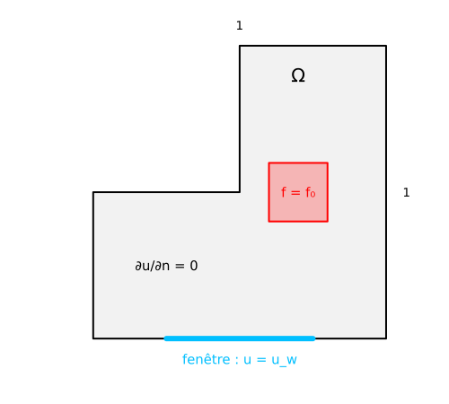
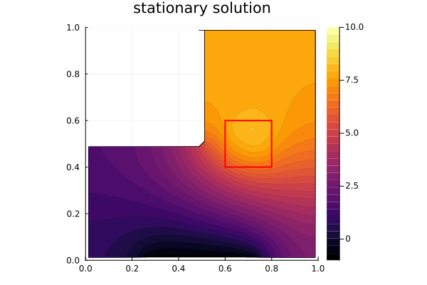
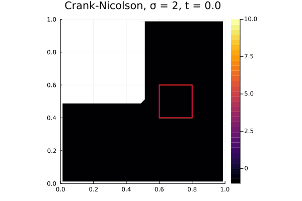
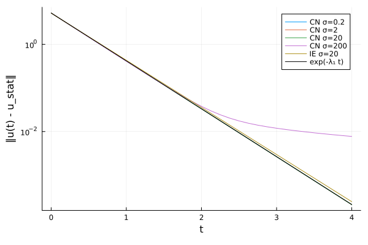
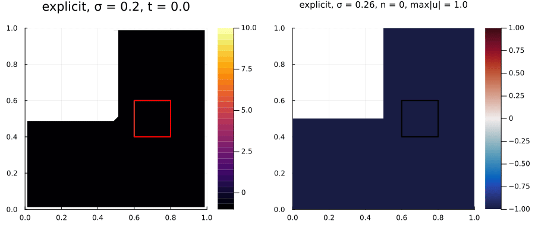

## MAM4 - EDP1
# 2026-27
# **TP 2 - Équation de la chaleur**

On souhaite simuler l'évolution de la température dans une pièce en forme de L
- dont le chauffage se situe au centre de la pièce, à droite du coin rentrant,
- dont les parois sont isolantes,
- à l'exception d'une fenêtre située sur le mur du bas.

On rappelle que cette température suit l'EDP de la chaleur 2D :

$$ \begin{aligned}
  & \frac{\partial u}{\partial t} - \nu\Delta u = f,\quad t > 0,\quad (x,y) \in \Omega,\\
  & u(0,x,y) = u_0(x,y),\quad  (x,y) \in \Omega,
\end{aligned} $$

avec des conditions aux limites appropriées sur le bord du domaine.

**Le problème.** La pièce est $\Omega := ]0,1[^2 \setminus [0,\tfrac12]\times[\tfrac12,1]$ (un carré dont on a retiré le coin supérieur gauche). Le chauffage est la source $f = f_0 = 250$ sur le carré $[0.6,0.8]\times[0.4,0.6]$ et $f = 0$ ailleurs, avec $\nu = 1$. Sur les parois, la condition est de Neumann homogène (parois isolantes) :
$$ \frac{\partial u}{\partial n} = 0, $$
à l'exception de la fenêtre $\{(x,0)\,;\ \tfrac14 \le x \le \tfrac34\}$ sur le mur du bas, où la température est imposée (Dirichlet inhomogène) : $u = u_w = -1$. À l'instant initial, la pièce est à la température de la fenêtre : $u_0 \equiv u_w$.



**Conventions numériques.**

- *Maillage en cellules.* On découpe le carré $]0,1[^2$ en $N \times N$ cellules carrées de côté $h = 1/N$, et l'on garde les cellules contenues dans $\Omega$ ; $N$ est un multiple de $20$ (pour que le coin retiré, le chauffage et la fenêtre soient formés de cellules entières). L'inconnue $u_k$ approche la température au centre de la cellule $k$. En Julia, la cellule $(j,i)$ est repérée par sa ligne $j$ (en $y$) et sa colonne $i$ (en $x$).
- *Différences finies.* On intègre $-\nu\Delta u = f$ sur chaque cellule : le flux à travers une face commune à deux cellules voisines $k$ et $l$ est approché par $-\nu(u_l - u_k)/h$ ; un mur isolant ne donne aucun flux (le terme correspondant est simplement absent) ; une face de la fenêtre est à la température $u_w$, à distance $h/2$ du centre de la cellule, d'où le flux $\nu(u_k - u_w)/(h/2)$.
- *Pas de temps.* On pose $\sigma := \nu\Delta t/h^2$ (la quantité $\sigma_x = \sigma_y$ du cours, ici $\Delta x = \Delta y = h$). Le temps final $t_f$ est fixé et $\Delta t = t_f/N_t$ avec $N_t$ le plus petit entier tel que $\nu\Delta t/h^2 \le \sigma$ : faire varier $\sigma$ ne change pas $t_f$.
- *Distance à l'état stationnaire.* On mesure $\|u\| := \big(h^2\sum_k u_k^2\big)^{1/2}$, la norme $L^2$ discrète.

Le code ci-dessous est à exécuter une fois en début de session.

```julia
using SparseArrays, LinearAlgebra, Plots

# Problem data

ν  = 1.0      # diffusion coefficient
uw = -1.0     # window temperature
f0 = 250.0    # heating power density
tf = 4.0      # final time

heater0 = ((0.6, 0.8), (0.4, 0.6))    # heater: x-range, y-range
umax = 10.0   # upper bound of the colour scale

# Geometry: Ω = ]0,1[² minus [0,1/2]×[1/2,1], cells of size h = 1/N.
# Cell (j, i): row j ↔ y, column i ↔ x. N must be a multiple of 20.
# Returns: mask (cells in Ω), win (cells touching the window), f (heating)

function lroom(N; heater = heater0)
    @assert N % 20 == 0
    mask = trues(N, N)
    mask[N÷2+1:N, 1:N÷2] .= false               # removed square
    win = falses(N, N)
    win[1, N÷4+1:3*N÷4] .= true                 # window: south wall, 1/4 ≤ x ≤ 3/4
    c = ((1:N) .- 0.5) / N                      # cell centres (in x and in y)
    (x0, x1), (y0, y1) = heater
    f = zeros(N, N)
    f[y0 .< c .< y1, x0 .< c .< x1] .= f0       # rows ↔ y, columns ↔ x
    @assert all(mask[f .> 0])                   # the heater must lie in Ω
    return mask, win, f
end

# Cell values (vector) → matrix with NaN outside Ω (NaN cells are not drawn)

field(u, mask) = (U = fill(NaN, size(mask)); U[mask] = u; U)

# Filled contour plot of the cell values u, with the heater drawn as a red square

function heatplot(u, mask; title = "", heater = heater0)
    N = size(mask, 1)
    xc = ((1:N) .- 0.5) / N
    p = contourf(xc, xc, field(u, mask); aspect_ratio = :equal, c = :inferno, levels = range(uw, umax, length = 33),
                 clims = (uw, umax), linewidth = 0, xlims = (0, 1), ylims = (0, 1), title = title)
    (x0, x1), (y0, y1) = heater
    plot!(p, [x0, x1, x1, x0, x0], [y0, y0, y1, y1, y0]; color = :red, linewidth = 2, label = false)
end
```

## Exercice 1

On commence par le problème stationnaire (Poisson) : trouver $u$ telle que $-\nu\Delta u = f$ dans $\Omega$ avec les conditions aux limites ci-dessus. Le code suivant assemble la matrice $A$ et le second membre $b$ du système linéaire $Au = b$.

```julia
# Finite difference assembly of A ≃ -νΔ and b (heating + Dirichlet data).
# Cells are numbered columnwise: idx[mask] = 1:K

function assemble(mask, win, f, h; ν = 1.0, uw = 0.0)
    K = count(mask)
    idx = zeros(Int, size(mask))
    idx[mask] = 1:K
    rows, cols, vals = Int[], Int[], Float64[]
    b = f[mask]                                 # new array
    for c ∈ findall(mask)                       # c = CartesianIndex(j, i)
        k = idx[c]
        d = 0.0
        for δ ∈ (CartesianIndex(0, -1), CartesianIndex(0, 1), CartesianIndex(-1, 0), CartesianIndex(1, 0))
            n = c + δ
            if checkbounds(Bool, mask, n) && mask[n]    # neighbour in Ω
                push!(rows, k); push!(cols, idx[n]); push!(vals, -ν / h^2)
                d += ν / h^2
            end                                          # else: insulating wall, no flux
        end
        if win[c]                                        # Dirichlet face at distance h/2
            d += 2ν / h^2
            b[k] += 2ν / h^2 * uw
        end
        push!(rows, k); push!(cols, k); push!(vals, d)
    end
    return sparse(rows, cols, vals, K, K), b, idx
end

N = 40
h = 1 / N
mask, win, f = lroom(N)
A, b, idx = assemble(mask, win, f, h; ν = ν, uw = uw)
K = size(A, 1)

# Stationary solution: -νΔu = f (A is symmetric positive definite)

ustat = cholesky(Symmetric(A)) \ b

# Plot (move the heater with lroom(N; heater = ...), or the window in `lroom`)

heatplot(ustat, mask)
```

**1.1** Montrer que, pour une cellule $k$, la ligne $k$ du système s'écrit
$$ \frac{\nu}{h^2}\Big( n_k u_k - \sum_{l \sim k} u_l \Big) + \frac{2\nu}{h^2}\,u_k\,\mathbf{1}_{k \in W} = f_k + \frac{2\nu}{h^2}\,u_w\,\mathbf{1}_{k \in W}, $$
où $l \sim k$ désigne les cellules voisines de $k$ *dans* $\Omega$, $n_k$ leur nombre et $W$ l'ensemble des cellules de la fenêtre. Écrire $A$ à l'aide du laplacien du graphe des cellules, et vérifier que $A$ est symétrique.

**Réponse.** On intègre $-\nu\Delta u = f$ sur la cellule $k$ et on applique la formule de Green : $\int_{\partial k} -\nu\,\partial_n u = \int_k f \simeq h^2 f_k$. Chaque face commune avec une cellule voisine $l \in \Omega$ contribue $h \cdot \nu (u_k - u_l)/h = \nu(u_k - u_l)$. Une face sur un mur isolant contribue $0$. Une face de la fenêtre contribue $h\cdot\nu(u_k - u_w)/(h/2) = 2\nu(u_k - u_w)$. En divisant par $h^2$ on obtient la ligne annoncée. Donc
$$ A = \frac{\nu}{h^2}\,L + \frac{2\nu}{h^2}\,D_W, \qquad b = f + \frac{2\nu}{h^2}\,u_w\,\mathbf{1}_W, $$
où $L = \mathrm{diag}(n_k) - (\text{matrice d'adjacence})$ est le laplacien du graphe des cellules et $D_W$ la diagonale de l'indicatrice de $W$. Les deux matrices sont symétriques : l'adjacence l'est (si $l \sim k$ alors $k \sim l$) et les termes diagonaux aussi.

**1.2** Montrer que $A$ est symétrique définie positive. Quel est le rôle de la fenêtre ? Que se passerait-il sans fenêtre (Neumann sur tout le bord) ?

**Réponse.** Pour tout $v$,
$$ v^\top A v = \frac{\nu}{h^2}\sum_{\{k,l\}\ \text{voisines}} (v_k - v_l)^2 + \frac{2\nu}{h^2}\sum_{k \in W} v_k^2 \ \ge\ 0. $$
Si $v^\top A v = 0$, alors $v_k = v_l$ pour toutes les cellules voisines, donc $v$ est constant (la pièce est connexe), puis $v_k = 0$ sur $W$, qui est non vide : $v = 0$. Donc $A$ est définie positive. Sans fenêtre, le second terme disparaît et les constantes sont dans le noyau de $A$ : le problème de Neumann pur est singulier, et il n'a de solution que si $\int f = 0$. Physiquement, une pièce isolée et chauffée n'a pas d'état stationnaire : la température monte indéfiniment. La fenêtre évacue la chaleur et rend le problème bien posé.

**1.3** Exécuter le code et tracer la solution stationnaire. Vérifier numériquement le bilan d'énergie : la puissance de chauffe $h^2\sum_k f_k$ est égale au flux sortant par la fenêtre $h^2\sum_{k\in W}\frac{2\nu}{h^2}(u_k - u_w)$. Démontrer ce bilan au niveau discret.

```julia
# Energy balance: heating power = flux through the window

power = h^2 * sum(f)
flux  = h^2 * sum(2ν / h^2 * (ustat[idx[win]] .- uw))
@show power flux
```

**Réponse.** Pour $N = 40$, $h^2\sum_k f_k = 10$ (soit $250 \times 0.2 \times 0.2 = 10$) et le flux par la fenêtre vaut $10$ à $10^{-12}$ près. Démonstration : on somme les lignes du système, c'est-à-dire $\mathbf{1}^\top A u = \mathbf{1}^\top b$. Comme $L\mathbf{1} = 0$ et que $L$ est symétrique, $\mathbf{1}^\top L = 0$, et il reste
$$ \frac{2\nu}{h^2}\sum_{k\in W} u_k = \sum_k f_k + \frac{2\nu}{h^2}\,u_w\,|W|, \quad\text{i.e.}\quad h^2\sum_{k\in W}\frac{2\nu}{h^2}(u_k - u_w) = h^2\sum_k f_k. $$
La température maximale vaut $8.30$ pour $N = 40$, atteinte dans le chauffage.



**1.4** Déplacer le chauffage (argument `heater` de `lroom`) et la fenêtre, et commenter. Par exemple, comparer le chauffage en $[0.6,0.8]\times[0.4,0.6]$ et en $[0.6,0.8]\times[0,0.2]$ : que devient la température maximale, à puissance de chauffe égale ? Le bilan d'énergie change-t-il ?

**Réponse.** Le bilan d'énergie ne change pas : le flux par la fenêtre est toujours égal à la puissance de chauffe ($10$ dans les deux cas). En revanche la température maximale passe de $8.30$ (chauffage au centre, loin de la fenêtre) à $2.20$ (chauffage en bas, près de la fenêtre), pour $N = 40$ : la chaleur est évacuée avant d'avoir pu se répartir dans la pièce.

**1.5** *Validation.* Pour vérifier le code d'assemblage, on prend le carré $]0,1[^2$ avec Dirichlet $u = 0$ sur tout le mur du bas et Neumann ailleurs, et $f(x,y) = \nu\frac{\pi^2}{4}\sin\big(\frac{\pi y}{2}\big)$. Donner la solution exacte, puis calculer l'erreur maximale aux centres des cellules pour $N = 20, 40, 80, 160$ et en déduire l'ordre observé.

```julia
# Validation: unit square, u = 0 on the whole south wall, Neumann elsewhere,
# f = (π²/4) sin(πy/2) (ν = 1); exact solution u = sin(πy/2)

function test_square(N)
    h = 1 / N
    mask = trues(N, N)
    win = falses(N, N)
    win[1, :] .= true
    y = ((1:N) .- 0.5) * h
    f = repeat(π^2 / 4 * sin.(π * y / 2), 1, N)
    A, b, _ = assemble(mask, win, f, h)         # ν = 1, uw = 0
    u = cholesky(Symmetric(A)) \ b
    return maximum(abs.(u - vec(repeat(sin.(π * y / 2), 1, N))))
end

for N ∈ (20, 40, 80, 160)
    println("N = $N: max error = $(test_square(N))")
end
```

**Réponse.** La solution exacte est $u(x,y) = \sin(\pi y/2)$ : elle vérifie $-\nu u_{yy} = \nu\frac{\pi^2}{4}\sin(\pi y/2)$, $u(x,0) = 0$, $\partial_y u(x,1) = \frac{\pi}{2}\cos\frac{\pi}{2} = 0$ et $\partial_x u = 0$. L'erreur maximale vaut $5.1\cdot10^{-4}$, $1.3\cdot10^{-4}$, $3.2\cdot10^{-5}$, $8.0\cdot10^{-6}$ : elle est divisée par $4$ quand $h$ est divisé par $2$, soit un ordre $2$ (la condition de Dirichlet à distance $h/2$ du centre est bien d'ordre $2$).

**1.6** *Convergence sur la pièce en L.* Calculer $\int_\Omega u \simeq h^2\sum_k u_k$ et $\max u$ pour $N = 20, 40, 80, 160$. Quel ordre observe-t-on ? Pourquoi est-il différent de celui de la question précédente ?

```julia
# Convergence on the L-shaped room: ∫u ≃ h² Σ u_k and max u

function steady(N)
    h = 1 / N
    mask, win, f = lroom(N)
    A, b, _ = assemble(mask, win, f, h; ν = ν, uw = uw)
    u = cholesky(Symmetric(A)) \ b
    return h^2 * sum(u), maximum(u)
end

for N ∈ (20, 40, 80, 160)
    I, m = steady(N)
    println("N = $N: ∫u = $I, max u = $m")
end
```

**Réponse.** On obtient

| $N$ | $20$ | $40$ | $80$ | $160$ |
|---|---|---|---|---|
| $\int_\Omega u$ | $3.319$ | $3.235$ | $3.196$ | $3.178$ |
| $\max u$ | $8.47$ | $8.30$ | $8.22$ | $8.19$ |

Les différences successives de $\int_\Omega u$ sont $0.083$, $0.039$, $0.019$ : leur rapport est proche de $2$, donc la convergence est d'ordre $1$ (et non $2$). La solution n'est pas régulière : elle présente des singularités aux deux extrémités de la fenêtre, où la condition passe de Dirichlet à Neumann (comportement en $r^{1/2}$ avec $r$ la distance au point de raccord), et au coin rentrant $(\tfrac12,\tfrac12)$ (comportement en $r^{2/3}$). Dans le cas test, la solution est régulière, d'où l'ordre $2$.

## Exercice 2

On calcule maintenant l'évolution temporelle de la température. On utilise le $\theta$-schéma
$$ \frac{u^{n+1} - u^n}{\Delta t} + A\big(\theta u^{n+1} + (1-\theta)u^n\big) = b, $$
c'est-à-dire
$$ (I + \theta\Delta t\,A)\,u^{n+1} = \big(I - (1-\theta)\Delta t\,A\big)u^n + \Delta t\,b, $$
où $A$ et $b$ sont ceux de l'exercice 1 ($b$ contient à la fois le chauffage et la donnée de Dirichlet). Le cas $\theta = 0$ est le schéma explicite, $\theta = 1$ le schéma d'Euler implicite et $\theta = \tfrac12$ le schéma de Crank-Nicolson.

**2.1** Pour une cellule intérieure (ses quatre voisines sont dans $\Omega$, pas de terme source), écrire le schéma de Crank-Nicolson ($\theta = \frac12$) et le comparer à
$$ \begin{aligned}
  & u_k^{n+1} - \frac{\sigma}{2}(u_{kW}^{n+1} - 2u_k^{n+1} + u_{kE}^{n+1})
              - \frac{\sigma}{2}(u_{kN}^{n+1} - 2u_k^{n+1} + u_{kS}^{n+1})\\
  & = u^n_k   + \frac{\sigma}{2}(u_{kW}^n - 2u_k^n + u_{kE}^{n})
              + \frac{\sigma}{2}(u_{kN}^n - 2u_k^n + u_{kS}^n) + \Delta t\, f_k,
\end{aligned} $$
où $\sigma = \nu\Delta t/h^2$ (c'est le schéma du cours avec $\sigma_x = \sigma_y = \sigma$, car $\Delta x = \Delta y = h$). Que deviennent les termes de bord (mur isolant, fenêtre) dans l'écriture matricielle ?

**Réponse.** Pour une cellule intérieure, $(Au)_k = \frac{\nu}{h^2}(4u_k - u_{kW} - u_{kE} - u_{kS} - u_{kN})$, donc $\big((I + \tfrac{\Delta t}{2}A)u\big)_k = u_k - \frac{\sigma}{2}(u_{kW} - 2u_k + u_{kE}) - \frac{\sigma}{2}(u_{kS} - 2u_k + u_{kN})$ avec $\sigma = \nu\Delta t/h^2$ : on retrouve exactement le schéma de l'énoncé. Pour une cellule au bord, la forme matricielle absorbe les conditions aux limites : le mur isolant supprime le voisin manquant dans la ligne de $A$ (Neumann), et la fenêtre ajoute $\frac{2\nu}{h^2}$ sur la diagonale de $A$ et $\frac{2\nu}{h^2}u_w$ dans $b$ (Dirichlet).

**2.2** *Stabilité.* Les valeurs propres de $A$ sont notées $0 < \lambda_1 \le \dots \le \lambda_K$. Exprimer le facteur d'amplification du $\theta$-schéma sur chaque mode propre. Montrer que le schéma de Crank-Nicolson est stable pour tout $\Delta t > 0$. Montrer que $\lambda_K \le 8\nu/h^2$ (lemme de Gershgorin) et en déduire une condition suffisante de stabilité pour le schéma explicite en fonction de $\sigma$.

**Réponse.** $A$ est symétrique définie positive, donc diagonalisable dans une base orthonormée. Sur le mode propre associé à $\lambda$, le schéma multiplie l'amplitude par
$$ a(\lambda) = \frac{1 - (1-\theta)\Delta t\lambda}{1 + \theta\Delta t\lambda}. $$
Pour $\theta = \frac12$, $a = \frac{1 - z}{1 + z}$ avec $z = \Delta t\lambda/2 > 0$, donc $|a| < 1$ pour tout $\Delta t > 0$ : le schéma est inconditionnellement stable. Pour $\theta = 1$, $a = 1/(1 + \Delta t\lambda) \in (0,1)$ : également inconditionnellement stable. Pour $\theta = 0$, $a = 1 - \Delta t\lambda$ et $|a| \le 1$ pour tous les modes si et seulement si $\Delta t\lambda_K \le 2$. D'après Gershgorin, chaque valeur propre est dans un disque de centre $A_{kk}$ et de rayon $\sum_{l\neq k}|A_{kl}| = \frac{\nu}{h^2}n_k$ ; pour une cellule intérieure $A_{kk} = 4\nu/h^2$ et le rayon vaut $4\nu/h^2$, et pour une cellule de la fenêtre au pied d'un mur ($3$ voisines) $A_{kk} = 5\nu/h^2$ et le rayon $3\nu/h^2$. Donc $\lambda_K \le 8\nu/h^2$, et $\sigma = \nu\Delta t/h^2 \le \frac14$ suffit. Numériquement, pour $N = 40$, $\lambda_K = 12775 \simeq 8\nu/h^2 = 12800$ : la condition est quasiment nécessaire, et $\lambda_1 = 2.529$.

**2.3** Compléter la fonction `evolve` (`# TBC`) pour programmer le $\theta$-schéma, puis exécuter Crank-Nicolson avec $\sigma = 2$ et $t_f = 4$. Que se passe-t-il au bout d'un temps long ? Comparer avec la solution stationnaire de l'exercice 1 en traçant $\|u(t) - u_{\mathrm{stat}}\|$ en fonction de $t$ (échelle logarithmique), pour Crank-Nicolson avec $\sigma = 0.2,\ 2,\ 20,\ 200$ et Euler implicite avec $\sigma = 20$. Quelle est la vitesse de convergence observée ? La relier à $\lambda_1$ (obtenue par `eigvals(Symmetric(Matrix(A)), 1:1)`).

```julia
# θ-scheme: (I + θΔt A) uⁿ⁺¹ = (I - (1-θ)Δt A) uⁿ + Δt b.
# θ = 0: explicit, θ = 1/2: Crank-Nicolson, θ = 1: implicit Euler.
# tf is fixed; the number of steps is deduced from σ = νΔt/h²

Id = sparse(1.0I, K, K)
nsteps(σ, T) = ceil(Int, T * ν / (σ * h^2) - 1e-9)
dist(u) = h * norm(u - ustat)                   # distance to the stationary solution

function evolve(θ, σ; T = tf, callback = (n, t, u) -> nothing)
    Nt = nsteps(σ, T)
    Δt = T / Nt
    F = cholesky(Symmetric(Id + θ * Δt * A))    # factorisation, once and for all
    E = Id - (1 - θ) * Δt * A
    u = fill(uw, K)                             # u0 = uw
    err = [dist(u)]
    callback(0, 0.0, u)
    for n ∈ 1:Nt
        u = F \ (E * u + Δt * b)
        push!(err, dist(u))
        callback(n, n * Δt, u)
    end
    return u, err, Δt
end

# Crank-Nicolson, σ = 2: distance to the stationary solution along time

u, err, Δt = evolve(0.5, 2.0)

p = plot(; yscale = :log10, xlabel = "t", ylabel = "‖u(t) - u_stat‖")
for (θ, σ, name) ∈ ((0.5, 0.2, "CN σ=0.2"), (0.5, 2.0, "CN σ=2"), (0.5, 20.0, "CN σ=20"), (0.5, 200.0, "CN σ=200"), (1.0, 20.0, "IE σ=20"))
    _, e, dt = evolve(θ, σ)
    plot!(p, (0:length(e)-1) * dt, e; label = name)
end
display(p)

# Slowest mode: smallest eigenvalue of A (dense, K ≃ 1200)

λ1 = eigvals(Symmetric(Matrix(A)), 1:1)[1]
```

**Réponse.** La température converge vers la solution stationnaire de l'exercice 1 (le chauffage est constant) : $\|u(t) - u_{\mathrm{stat}}\|$ passe de $5.24$ à $t = 0$ à $0.41$ en $t = 1$ puis à $2.1\cdot10^{-4}$ en $t = 4$ (Crank-Nicolson, $\sigma = 0.2,\ 2,\ 20$ : les trois courbes sont confondues à trois chiffres). La décroissance est exponentielle, de taux $\lambda_1 = 2.53$, ce qui est la courbe $e^{-\lambda_1 t}$ de la figure : $5.24\cdot e^{-4\lambda_1} = 2.1\cdot10^{-4}$, ce qui coïncide à $1\,\%$ près avec la valeur observée. En effet $u(t) - u_{\mathrm{stat}}$ se décompose sur les modes propres de $A$ avec des amplitudes $e^{-\lambda t}$, et le mode le plus lent domine (constante de temps $1/\lambda_1 \simeq 0.4$).





**2.4** *Schéma explicite.* Exécuter `evolve(0.0, σ)` pour $\sigma = 0.2$ et $\sigma = 0.26$ (avec un temps final plus court si besoin). Combien de pas de temps faut-il à $t_f = 4$ pour le schéma explicite à la limite de stabilité, pour Crank-Nicolson avec $\sigma = 2$ et avec $\sigma = 20$ ? Commenter le coût.

**Réponse.** Pour $\sigma = 0.2$ le schéma explicite donne la même solution que Crank-Nicolson, mais pour $\sigma = 0.26$ il explose : le maximum de $|u|$ atteint $1\cdot10^{4}$ au pas $300$ et $2\cdot10^{7}$ au pas $400$, et la solution dépasse $10^{100}$ au bout d'environ $3300$ pas (puis `Inf` et `NaN`). On voit l'instabilité se développer sous forme d'oscillations d'une maille à l'autre (en damier), amorcées par les arêtes du chauffage ; le mode instable est celui de plus grande valeur propre, $a = 1 - \Delta t\lambda_K \simeq 1 - 8\sigma < -1$ dès que $\sigma > 1/4$.

Sur l'animation, à gauche le schéma explicite stable ($\sigma = 0.2$) jusqu'à $t = 1$ ($8000$ pas), à droite le schéma instable ($\sigma = 0.26$) sur ses $400$ premiers pas, avec une échelle de couleurs symétrique $\pm\max|u|$ qui suit l'explosion (rouge positif, bleu négatif) : on voit le damier se former.



Le nombre de pas pour $t_f = 4$ est $32\,000$ ($\sigma = 0.2$, explicite), $3200$ ($\sigma = 2$) et $320$ ($\sigma = 20$). Chaque pas de Crank-Nicolson coûte une résolution avec la factorisation (calculée une seule fois), plus chère qu'un produit matrice-vecteur, mais le gain de dix à cent fois en nombre de pas compense largement tant qu'on n'a pas besoin de résoudre la dynamique rapide.

**2.5** *Ordre en temps.* Calculer une solution de référence à $t = 0.5$ avec Crank-Nicolson et $\sigma = 0.02$, puis l'erreur de Crank-Nicolson et d'Euler implicite pour $\sigma = 0.2,\ 0.4,\ \dots,\ 6.4$. Quels ordres observe-t-on ?

```julia
# Order in time at t = 0.5: reference = Crank-Nicolson with σ = 0.02

uref, _, _ = evolve(0.5, 0.02; T = 0.5)
for θ ∈ (0.5, 1.0), σ ∈ (0.2, 0.4, 0.8, 1.6, 3.2, 6.4)
    uθ, _, _ = evolve(θ, σ; T = 0.5)
    println("θ = $θ, σ = $σ: error = $(h * norm(uθ - uref))")
end
```

**Réponse.** Les erreurs $\|u^{N_t} - u_{\mathrm{ref}}\|$ à $t = 0.5$ sont :

| $\sigma$ | $0.2$ | $0.4$ | $0.8$ | $1.6$ | $3.2$ | $6.4$ |
|---|---|---|---|---|---|---|
| Crank-Nicolson | $1.5\cdot10^{-8}$ | $6.2\cdot10^{-8}$ | $2.5\cdot10^{-7}$ | $9.9\cdot10^{-7}$ | $4.0\cdot10^{-6}$ | $1.6\cdot10^{-5}$ |
| Euler implicite | $2.9\cdot10^{-4}$ | $5.9\cdot10^{-4}$ | $1.2\cdot10^{-3}$ | $2.3\cdot10^{-3}$ | $4.7\cdot10^{-3}$ | $9.4\cdot10^{-3}$ |

Quand $\Delta t$ (donc $\sigma$) double, l'erreur est multipliée par $4$ pour Crank-Nicolson (ordre $2$) et par $2$ pour Euler implicite (ordre $1$).

**2.6** *Pas de temps très grand.* Pour $\sigma = 200$, comparer Crank-Nicolson et Euler implicite : erreur à $t_f = 4$, et monotonie en temps. Pourquoi la température doit-elle être croissante en tout point (rappel : $f \ge 0$ et $u_0 \equiv u_w$) ? Ce que l'on observe est-il compatible avec cette propriété ? Expliquer avec $a(\lambda)$ quand $\Delta t\lambda \to \infty$.

```julia
# Monotonicity: smallest increment uⁿ⁺¹_k - uⁿ_k over all cells and steps

function min_increment(θ, σ)
    uprev = fill(uw, K)
    m = Inf
    evolve(θ, σ; callback = (n, t, u) -> begin
        n > 0 && (m = min(m, minimum(u - uprev)))
        uprev = copy(u)
    end)
    return m
end

for (θ, name) ∈ ((0.5, "Crank-Nicolson"), (1.0, "implicit Euler"))
    _, e, _ = evolve(θ, 200.0)
    println("$name, σ = 200: error at tf = $(e[end]), min increment = $(min_increment(θ, 200.0))")
end

# Explicit scheme just above and just below σ = 1/4 (T shortened to 400 steps)

for σ ∈ (0.2, 0.26)
    ux, _, _ = evolve(0.0, σ; T = 400 * σ * h^2 / ν)
    println("explicit, σ = $σ: max|u| after 400 steps = $(maximum(abs, ux))")
end
```

**Réponse.** Pour $\sigma = 200$, l'erreur à $t_f = 4$ vaut $7.7\cdot10^{-3}$ pour Crank-Nicolson contre $7.9\cdot10^{-4}$ pour Euler implicite : Crank-Nicolson, qui est pourtant d'ordre $2$, fait moins bien. Le plus petit incrément $u^{n+1}_k - u^n_k$ vaut $-0.81$ pour Crank-Nicolson, alors qu'il reste positif (de l'ordre de $10^{-5}$) pour Euler implicite. La température doit être croissante parce que $v := \partial_t u$ vérifie la même équation de la chaleur, avec la donnée initiale $v(0) = \nu\Delta u_0 + f = f \ge 0$ (en prenant $u_0 \equiv u_w$) et des conditions aux limites homogènes ; le principe du maximum donne $v \ge 0$. Pour Euler implicite, $a(\lambda) = 1/(1 + \Delta t\lambda) \to 0^+$ : les modes rapides sont éteints sans changer de signe. Pour Crank-Nicolson, $a(\lambda) = \frac{1 - z}{1 + z} \to -1$ quand $z = \Delta t\lambda/2 \to \infty$ : pour $\sigma = 200$ le mode le plus raide a $|a| = 0.9975$, donc il n'est pratiquement pas amorti et il change de signe à chaque pas. Crank-Nicolson est $A$-stable mais pas $L$-stable : au-delà d'un certain pas de temps, on perd la monotonie et la précision des modes rapides.

## Annexe. Figures et animations

Le code suivant produit les figures et les GIF du corrigé et le schéma de la pièce de l'énoncé (le GIF ci-dessous est celui de la question 2.3) ; il utilise les objets définis plus haut.

```julia
# Sketch of the room (used in the statement)

sketch = plot(; aspect_ratio = :equal, xlims = (-0.12, 1.12), ylims = (-0.12, 1.12), legend = false, framestyle = :none, size = (500, 450))
plot!(sketch, Shape([0, 1, 1, 0.5, 0.5, 0], [0, 0, 1, 1, 0.5, 0.5]); fillcolor = :gray95, linecolor = :black, linewidth = 2)
(x0, x1), (y0, y1) = heater0
plot!(sketch, Shape([x0, x1, x1, x0], [y0, y0, y1, y1]); fillcolor = :red, fillalpha = 0.25, linecolor = :red, linewidth = 2)
plot!(sketch, [0.25, 0.75], [0, 0]; color = :deepskyblue, linewidth = 6)
annotate!(sketch, 0.7, 0.9, text("Ω", 14)); annotate!(sketch, 0.7, 0.5, text("f = f₀", 10, :red))
annotate!(sketch, 0.5, -0.07, text("fenêtre : u = u_w", 10, :deepskyblue)); annotate!(sketch, 0.25, 0.25, text("∂u/∂n = 0", 10))
annotate!(sketch, 0.5, 1.07, text("1", 9)); annotate!(sketch, 1.07, 0.5, text("1", 9))
savefig(sketch, "chaleur_piece.png")

# Stationary solution (question 1.3)

heatplot(ustat, mask; title = "stationary solution")
savefig("chaleur_stationnaire.png")

# Error curves (question 2.3), with the slowest-mode rate e^(-λ₁ t)

t = range(0, tf, length = 50)
plot!(p, t, dist(fill(uw, K)) * exp.(-λ1 * t); color = :black, label = "exp(-λ₁ t)")
savefig(p, "chaleur_erreur.png")

# Crank-Nicolson, σ = 2 (question 2.3): 40 frames

heat(u, title) = heatplot(u, mask; title = title)
every = nsteps(2.0, tf) ÷ 40
anim = Animation()
evolve(0.5, 2.0; callback = (n, t, u) -> begin
    n % every == 0 && frame(anim, heat(u, "Crank-Nicolson, σ = 2, t = $(round(t, digits = 2))"))
end)
gif(anim, "chaleur_cn.gif"; fps = 10)

# Explicit scheme (question 2.4): σ = 0.2 (stable) up to t = 1 (8000 steps), next to
# σ = 0.26 (unstable), first 400 steps; 51 frames each

stable, unstable = [], []
evolve(0.0, 0.2; T = 1.0, callback = (n, t, u) -> n % 160 == 0 && push!(stable, (t, copy(u))))
evolve(0.0, 0.26; T = 400 * 0.26 * h^2 / ν, callback = (n, t, u) -> n % 8 == 0 && push!(unstable, (n, copy(u))))
# Unstable field: values of alternating sign that blow up, drawn with a symmetric scale ±max|u|

xc = ((1:N) .- 0.5) * h
function unstable_plot(u, n)
    m = maximum(abs, u)
    p = heatmap(xc, xc, field(u, mask); aspect_ratio = :equal, c = :balance, clims = (-m, m), xlims = (0, 1), ylims = (0, 1),
                title = "explicit, σ = 0.26, n = $n, max|u| = $(round(m, sigdigits = 2))", titlefontsize = 10)
    (x0, x1), (y0, y1) = heater0
    plot!(p, [x0, x1, x1, x0, x0], [y0, y0, y1, y1, y0]; color = :black, linewidth = 2, label = false)
end
anim = Animation()
for ((t, us), (n, uu)) ∈ zip(stable, unstable)
    frame(anim, plot(heat(us, "explicit, σ = 0.2, t = $(round(t, digits = 2))"),
                     unstable_plot(uu, n); layout = (1, 2), size = (900, 400)))
end
gif(anim, "chaleur_explicite.gif"; fps = 10)
```
